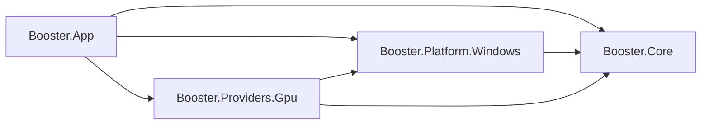
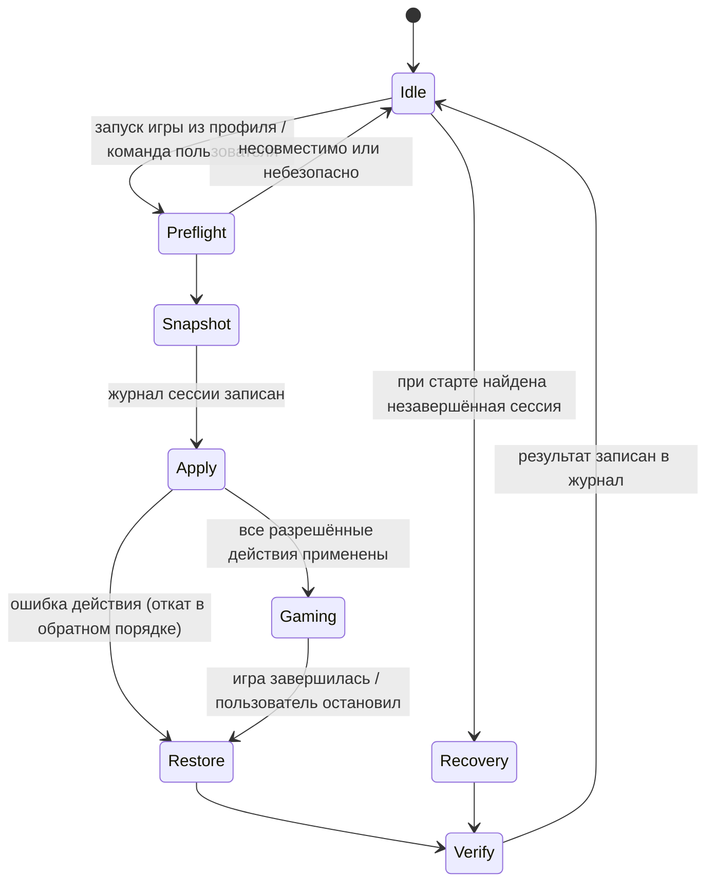

# Архитектура Booster

Целевая архитектура полного приложения. Реализуется поэтапно (`docs/ROADMAP.md`); у компонентов, которые появятся позже, указан этап. Принципы, модель безопасности и запреты — `docs/PRINCIPLES.md`.

---

## 1. Проекты решения

```
Booster.sln
global.json                         фиксирует SDK 10.0.x
Directory.Build.props               общие настройки: Nullable, LangVersion, анализаторы
src/
  Booster.Core/                     net10.0          логика, модели, интерфейсы
  Booster.Platform.Windows/         net10.0-windows  доступ к ОС
  Booster.Providers.Gpu/            net10.0-windows  вендорские провайдеры GPU
  Booster.App/                      net10.0-windows  WPF, MVVM, DI-композиция
tests/
  Booster.Core.Tests/               net10.0
  Booster.Platform.Windows.Tests/   net10.0-windows  только парсинг и read-only
  Booster.Providers.Gpu.Tests/      net10.0-windows  провайдеры GPU на фейке NVAPI, раскладки структур
  Booster.App.Tests/                net10.0-windows  ViewModel и корень композиции на фейках
scripts/                            PowerShell, только диагностика (вывод — JSON); Start-Booster.cmd — запуск
config/                             встроенная конфигурация (копируется к exe)
docs/
```

| Проект | Назначение | Ссылается на |
|---|---|---|
| `Booster.Core` | Модели (`HardwareInventory`, `SystemSnapshot`, `FrameMetrics` …), интерфейсы источников данных, `ActionPolicy`, `CapabilityRegistry`, анализаторы, отчёты; игровые профили, действия, журнал и восстановление (Этап 2). Без вызовов Windows API. | — |
| `Booster.Platform.Windows` | Сбор данных: CIM/WMI, нативные API, реестр (только чтение), `powercfg`, счётчики производительности, запуск PresentMon. С Этапа 2 — схемы питания, приоритет и штатное закрытие процессов, файлы журнала и профилей. | Core |
| `Booster.Providers.Gpu` | Реализации `IGpuProvider`: Generic, NVIDIA, AMD, Intel (Этап 3). | Core, Platform.Windows |
| `Booster.App` | WPF-оболочка, ViewModels, `.resx`, композиция DI, настройка логирования. | Core, Platform.Windows, Providers.Gpu |



### Запуск

`scripts\Start-Booster.cmd` запускает Booster двойным щелчком, без настройки `DOTNET_ROOT`.

- **Поиск среды .NET 10 Desktop Runtime x64.** Порядок: заданный `DOTNET_ROOT`; установка в `%ProgramFiles%\dotnet`; портативная копия в `%USERPROFILE%\tools\dotnet`. Для портативной копии `DOTNET_ROOT` задаётся только для запускаемого процесса.
- **Выбор сборки.** Запускается `Booster.App.exe` из Release-сборки, а если её нет — из Debug.
- **Аргументы** передаются как есть. `Start-Booster.cmd --export <папка>` пишет отчёт без окна и возвращает код выхода Booster. Без аргументов консоль не ждёт закрытия окна.
- **Ошибки.** Нет среды или сборки — сообщение по-русски и код 1.

### Решения

- **`Booster.Core` собирается как `net10.0`, без `-windows`.** Так отсутствие Windows API в Core проверяется компилятором. Анализатор совместимости платформ (CA1416) помечает вызовы Windows-only API, а в Core предупреждения считаются ошибками, поэтому такой вызов ломает сборку. Тесты Core тоже собираются под `net10.0`. Остальные проекты — `net10.0-windows`.
- **Вендорские провайдеры — один проект.** Нативные библиотеки NVAPI (`nvapi64.dll`) и ADLX (`amdadlx64.dll`) поставляются с драйвером и загружаются динамически через `NativeLibrary.TryLoad`. Своих нативных бинарников мы не распространяем, поэтому отдельные проекты пока не нужны. Отдельный проект (например, `Booster.Providers.Gpu.Amd`) появится, если вендорская обёртка потребует собственную нативную DLL. Это решится на Этапе 3.
- **`IGpuProvider` объявлен в Core** (`Abstractions/`): Rules Engine работает с возможностями GPU, не зная реализаций. В `Booster.Providers.Gpu` лежат только реализации.
- **Инвентаризация GPU (`GpuDetector`) живёт в Platform**, отдельно от вендорских провайдеров. Список адаптеров нужен до выбора провайдера, а провайдер отвечает за возможности и телеметрию конкретного адаптера.
- **`Booster.Elevated` не создан.** Ни одному действию Этапа 2 права администратора не нужны (раздел 8). Брокер появится, только если его потребует действие следующего этапа.

### Модули и проекты

| Модуль | Проект / папка |
|---|---|
| `Core/`: Orchestrator, RulesEngine, CapabilityRegistry, ActionPolicy, AppStateMachine | `Booster.Core/Engine/`: папка переименована, иначе получится пространство имён `Booster.Core.Core` |
| Модели инвентаризации (`HardwareInventory`, `SystemSnapshot`, …) | `Booster.Core/Inventory/` |
| Интерфейсы, `Reading<T>`, `SafetyLevel`, `ActionDescriptor` | `Booster.Core/Abstractions/` |
| Загрузка и миграция конфигурации | `Booster.Core/Configuration/` |
| `Profiles/`, `Recovery/`, `Reports/` | `Booster.Core/<папка>/` (доступ к файлам — через интерфейсы) |
| Расчёт метрик кадров (`FrameMetricsCalculator`) | `Booster.Core/Metrics/` |
| FPS Benchmark: `BenchmarkRunner`, `StutterAnalyzer`, `BottleneckAnalyzer`, `RecommendationEngine`, `BenchmarkComparer` | `Booster.Core/Benchmark/` (Этап 4) |
| `Hardware/`, `Drivers/`, `Providers/Windows/`, `Memory/`, `Monitoring/` (сбор данных) | `Booster.Platform.Windows/<папка>/` |
| `DriverVersionMatcher`, `MemoryPressureAnalyzer`, `StutterAnalyzer` и другие анализаторы | `Booster.Core/` (анализ отделён от сбора) |
| `Providers/GPU/` | `Booster.Providers.Gpu/` |

---

## 2. Сторонние зависимости

Перед подключением каждой новой зависимости проверяется лицензия, результат вносится сюда.

| Пакет / компонент | Лицензия | Где используется | Статус |
|---|---|---|---|
| CommunityToolkit.Mvvm | MIT | App | Этап 1 |
| Microsoft.Extensions.Hosting / DependencyInjection / Logging / Options | MIT | App, Core (абстракции) | Этап 1 |
| Serilog.Extensions.Hosting + Serilog.Sinks.File | Apache-2.0 | только App, запись логов в файл за `ILogger<T>` | Этап 1 |
| System.Management | MIT | Platform, запросы WMI | Этап 1 |
| Microsoft.Windows.CsWin32 | MIT | Platform, генерация P/Invoke (DXGI, D3D12, DisplayConfig, Kernel32) на этапе сборки. Если нужного API нет в метаданных (D3DKMT), P/Invoke пишется вручную | Этап 1 |
| System.Diagnostics.PerformanceCounter | MIT | Platform, счётчики `GPU Engine` | Этап 1 |
| System.Diagnostics.EventLog | MIT | Platform, чтение журналов System и Application (`EventLogReader`) для журнала стабильности | Этап 5 |
| xunit.v3 | Apache-2.0 | tests | Этап 1 |
| Microsoft.Extensions.TimeProvider.Testing | MIT | tests, детерминированные таймауты | Этап 1 |
| PresentMon 2.6.0 (GameTechDev, консольное приложение) | MIT | внешний процесс, в репозиторий не коммитится | Этап 1, способ поставки — в плане этапа |
| NVAPI (заголовки `NVIDIA/nvapi`) | MIT | Providers.Gpu: прямой вызов `nvapi64.dll` драйвера через `nvapi_QueryInterface`; DLL ставится с драйвером в `System32` и с Booster не распространяется. Только функции чтения из белого списка, `NvAPI_DRS_SetSetting`/`SaveSettings` не привязываются | Этап 3 |
| ADLX SDK (AMD) | ADLX SDK License Agreement, закрытая: распространение только в объектном коде с EULA, содержащим условия её раздела 3; раздел 4 запрещает использование под свободной лицензией | не подключён: Booster распространяется под MIT, а раздел 4 соглашения ADLX это запрещает; карт AMD для проверки нет, ошибка в раскладке C++-интерфейса роняет процесс | открытый вопрос (раздел 14) |
| IGCL (Intel) | Intel Software License Agreement: только на платформах Intel, условия распространения того же рода | не подключён по тем же причинам | открытый вопрос (раздел 14) |

Драйверы ядра от сторонних библиотек сенсоров не используются.

---

## 3. Известное и неизвестное: представление данных

Любое значение, полученное из ОС или от провайдера, хранится как `Reading<T>`, а не как голый `T`:

```csharp
public enum DataStatus { Available, Unknown, RequiresAdmin, NotSupported, Failed }

public readonly record struct Reading<T>(
    T? Value,
    DataStatus Status,
    string? Source,      // откуда взято: "WMI Win32_Processor", "DXGI", ...
    string? Note);       // пояснение для UI и лога
```

- Провайдер не подставляет значения по умолчанию. Нет надёжного значения — статус `Unknown` и, если известно, причина.
- Пример ненадёжного источника: `Win32_VideoController.AdapterRAM` — 32-битное поле, которое упирается в 4 ГБ. Для VRAM оно не используется, вместо него берётся `DedicatedVideoMemory` из DXGI.
- Двухканальный режим RAM, скорость памяти, Resizable BAR, температуры на Этапе 1 — `Unknown`. Сопутствующие подсказки (например, метки слотов `ChannelA`/`ChannelB`) показываются как подсказки, но не как вывод.
- UI показывает статус человеческим текстом («Неизвестно», «Нужны права администратора», «Не поддерживается»), а во всплывающей подсказке — источник.
- Таблицы на экранах сортируются щелчком по заголовку (`TableSorting` для DataGrid, `ReportTableGrid` для таблиц отчёта). Порядок задаёт `TableOrder` из Core: размеры и скорости — по величине с учётом единиц («512 МБ» раньше «1,2 ГБ»), даты — как даты, номера и версии — по числам. Недоступное значение не считается самым маленьким: «Неизвестно», «—» и ячейки с тоном `Unavailable` всегда в конце, в любом направлении.

---

## 4. Ключевые интерфейсы

Базовые интерфейсы (`IHardwareProvider`, `IOptimizationRule`, `IReversibleAction`, `ActionDescriptor`, `IGpuProvider`) сохраняются по смыслу. Ниже — расширения и дополнения; детали сигнатур фиксируются в коде.

```csharp
// --- Сбор данных (реализации в Platform) ---
public interface IHardwareProvider            // агрегирует детекторы, у каждой секции свой статус
{ Task<HardwareInventory> ScanAsync(CancellationToken ct); }

public interface IDriverInventoryProvider
{ Task<DriverInventory> ScanAsync(CancellationToken ct); }

public interface IFrameCaptureProvider        // PresentMon как внешний процесс
{
    Task<FrameCaptureAvailability> CheckAvailabilityAsync(CancellationToken ct);   // Mode: Direct | ElevationPrompt (запрос UAC)
    Task<FrameCaptureResult> CaptureAsync(FrameCaptureRequest request, Action? started, CancellationToken ct);
}
// Этап 4: результат со статусом вместо исключений — Completed, NotInstalled, ElevationDeclined, TargetNotFound, NoFrames,
// UnsupportedFormat, Failed, Cancelled; Capture — кадры FrameSample(PresentQpc, IntervalMs, CpuBusyMs, GpuBusyMs, SyncInterval),
// режимы показа и путь к CSV; RenderAdapter — LUID адаптера из CSV. started вызывается, когда PresentMon запущен (после согласия
// в UAC): от этого момента отсчитываются окна прогонов. FrameCaptureRequest(ProcessName | ProcessId, Duration)
// { StopWhenProcessExits — --terminate_on_proc_exit; Purpose — Benchmark | GameSession, у каждого своя ETW-сессия }.

public interface IPrivilegeInfo               // повышение прав, группа Performance Log Users
{ PrivilegeState GetCurrent(); }

// --- Датчики (Этап 3; контракты в Core, реализации в Providers.Gpu и Platform) ---
public interface IGpuProvider                 // вендорский (Vendor) или общий (Vendor == null); только чтение
{
    string ProviderId { get; }  GpuVendor? Vendor { get; }
    Task<bool> IsAvailableAsync(GpuAdapterInfo adapter, CancellationToken ct);
    Task<GpuCapabilities> GetCapabilitiesAsync(GpuAdapterInfo adapter, CancellationToken ct);
    Task<GpuTelemetry> ReadTelemetryAsync(GpuAdapterInfo adapter, CancellationToken ct);   // каждое поле — Reading<T>
    Task<GpuSettingsResult> ReadSettingsAsync(GpuAdapterInfo adapter, string? application, CancellationToken ct);
}

public interface ICpuSensorSource             // частота, предел производительности, температура CPU
{ CpuTelemetry Sample(); IReadOnlyList<CapabilityReport> DescribeCapabilities(); }

public interface ISensorProvider              // оркестрация провайдеров; слияние — GpuTelemetryMerger
{
    Task<SensorSurvey> SurveyAsync(IReadOnlyList<GpuAdapterInfo> adapters, IReadOnlyList<string> applications, CancellationToken ct);
    Task<SensorSnapshot> ReadAsync(CancellationToken ct);
}
// SensorProvider: аппаратные адаптеры с LUID; вендорский провайдер — первый доступный для производителя, общий — Vendor == null.
// Возможности — лучший статус по (id, область) у всех провайдеров производителя, даже недоступных; исключение провайдера —
// Failure в его полях. SensorRecorder.RecordAsync: замер сразу и раз в monitoring.sensorIntervalMs до отмены.
// ThermalThrottleDetector.Assess(замеры, ThrottleSettings) → ThrottleAssessment: признаки троттлинга с уверенностью
// High (причина от драйвера), Medium (температура у предела драйвера), Low (падение частоты под нагрузкой, ограничение CPU).

// --- Политика и возможности (реализации в Core) ---
public interface ICapabilityRegistry          // кто что умеет на этом железе
{
    void Report(CapabilityReport report);     // провайдер: возможность, статус, источник
    CapabilityState Get(string capabilityId);
    IReadOnlyCollection<CapabilityReport> All { get; }
}

public interface IActionPolicy                // единственная точка решения о любом действии
{ PolicyDecision Evaluate(ActionDescriptor action, ActionMode? configuredMode, PolicyContext context); }

public sealed record ActionDescriptor(
    string Id, string DisplayName, SafetyLevel Level,
    bool RequiresAdmin, bool RequiresReboot, bool RequiresConfirmation,
    bool IsReversible, bool AllowedDuringGaming,
    bool VerifiedForAutomatic);               // дополнение: L1, прошедшее проверку отката, — признак кода, а не конфигурации

// --- Отчёты ---
public interface IReportExporter { string Format { get; } Task ExportAsync(SystemReport report, Stream output, CancellationToken ct); }

// --- Этап 2: действия и восстановление (Core/Abstractions) ---
public interface IReversibleAction             // экземпляр живёт одну сессию
{
    string Id { get; }
    ActionDescriptor Descriptor { get; }
    Task<ActionSupport> CheckSupportAsync(CancellationToken ct);   // только чтение: поддерживается ли и нужно ли сейчас
    Task<ActionSnapshot> CaptureAsync(CancellationToken ct);       // исходное и целевое значение — в журнал до изменения
    Task<ApplyResult> ApplyAsync(CancellationToken ct);
}

public interface IActionRestorer               // возврат по снимку из журнала, без экземпляра действия
{
    string ActionId { get; }
    int SnapshotSchemaVersion { get; }
    Task<ObservedState> InspectAsync(ActionSnapshot snapshot, CancellationToken ct);  // Original | Applied | Other | Gone
    Task RevertAsync(ActionSnapshot snapshot, CancellationToken ct);                  // только после InspectAsync == Applied
}

// --- Этап 2: журнал и профили ---
public interface IChangeJournal                // Core/Recovery; файл на сессию
{
    Task SaveAsync(SessionRecord session, CancellationToken ct);   // переписывает <sessionId>.json целиком
    Task<JournalContents> LoadAsync(CancellationToken ct);         // сессии от новых к старым + нечитаемые файлы
    Task PruneAsync(int retainedFinished, CancellationToken ct);   // незавершённые и проблемные файлы не трогает
}
public interface IJournalFileStore             // реализация в Platform поверх AtomicFile; только имена файлов, без путей
{ IReadOnlyList<string> List(); Task<string> ReadAsync(string fileName, CancellationToken ct);
  Task WriteAsync(string fileName, string json, CancellationToken ct); void Delete(string fileName); }
public interface IProfileFileSource            // встроенные профили рядом с exe, пользовательские — в %LOCALAPPDATA%
{ IReadOnlyList<string> ListBuiltIn(); string ReadBuiltIn(string fileName); string? ReadUser(string fileName);
  Task WriteUserAsync(string fileName, string json, CancellationToken ct); }
public interface IActionCatalog                // null — id не реализован (recommend-only записи профиля)
{ IReversibleAction? Create(string actionId, GamingProfile profile, GameProcess? game); }

// --- Этап 2: система (реализации в Platform) ---
public interface IProcessProvider { IReadOnlyList<ProcessInfo> List(); ProcessIdentity? Identify(int processId); }
public interface IProcessPriorityController    // процесс опознаётся по паре PID + время старта
{ ProcessPriority? GetPriority(ProcessIdentity p); bool CanSetPriority(ProcessIdentity p); void SetPriority(ProcessIdentity p, ProcessPriority v); }
public interface IPowerPlanProvider            // только переключение между существующими схемами
{ IReadOnlyList<PowerScheme> ListSchemes(); Guid GetActiveScheme(); void SetActiveScheme(Guid id); PowerSource GetPowerSource(); }

// --- Этап 4: бенчмарк (контракты в Core, реализации в Platform; только чтение) ---
public interface IProcessActivitySource       // NtQuerySystemInformation: время CPU процессов и потоков, без открытия процессов
{ ProcessActivity Sample(string? processName, int? processId, int topCount); }
// ProcessActivity: загрузка всех логических CPU; цель — её загрузка, самый занятый поток (% одного логического CPU), число
// потоков; topCount самых нагружающих посторонних процессов.
public interface ISystemPressureSource        // GlobalMemoryStatusEx, «Memory\Page Reads/sec», «PhysicalDisk(_Total)»
{ SystemPressure Sample(); }                  // свободная память %, выделено от предела %, чтения страниц/с, занятость и задержка диска
// Оба источника считают скорости по разности двух вызовов: первый вызов — Unknown «нужен второй замер».
public interface IBenchmarkStore              // история серий; BenchmarkFileStore поверх AtomicFile (раздел 7)
{
    Task<BenchmarkSeries> SaveAsync(BenchmarkSeries series, CancellationToken ct);   // затем удаление старых сверх лимита
    Task<IReadOnlyList<BenchmarkSeries>> LoadAllAsync(CancellationToken ct);        // новые первыми; нечитаемые пропускаются
    Task DeleteAsync(string id, CancellationToken ct);
}
// BenchmarkRunner (Core): серия одним захватом PresentMon. BenchmarkRecorder пишет замеры датчиков, процессов и давления
// памяти и диска с меткой TimeProvider.GetTimestamp() — тот же QPC, что у кадров; сбой источника — null в его части замера.
// BenchmarkSeriesBuilder → BenchmarkSeries; BottleneckAnalyzer, RecommendationEngine, BenchmarkComparer — раздел 10.
```

**Отличия Этапа 2 от первоначального наброска:**
- **`IReversibleAction` без `RollbackAsync` и без `SystemSnapshot`.** После сбоя экземпляра действия уже нет, а восстанавливать нужно и тогда. Поэтому возврат вынесен в `IActionRestorer`: он работает только по `ActionSnapshot` из журнала и сначала читает текущее состояние (`InspectAsync`). Одинаковый путь у обычного восстановления и у восстановления после сбоя. Снимок системы действию не передаётся: каждое действие само читает то, что меняет.
- **`IJournalFileStore` вместо `IAtomicFileStore`.** Атомарная запись — внутренний `AtomicFile` в Platform (раздел 7). Core видит только каталог журнала по именам файлов, поэтому не может записать файл за его пределами.
- **`TimeProvider` вместо `IClock`.** Стандартный тип .NET даёт и текущее время, и таймеры (`Task.Delay(…, TimeProvider)`); в тестах — `FakeTimeProvider`.
- **`IProcessProvider` и опрос вместо `IProcessWatcher`.** Источники событий запуска процессов не подходят: `Win32_ProcessStartTrace` и ETW требуют прав администратора, а `__InstanceCreationEvent` сам опрашивает WMI, только тяжелее. `GameSessionCoordinator` раз в `monitoring.gameDetectionIntervalMs` из `settings.json` (2 с) читает список процессов и опрашивает, только если есть подготовленная сессия или профиль с автозапуском. Процесс опознаётся по паре PID и времени старта: PID может достаться другому процессу.

**`ActionPolicy`** возвращает одно из решений: `Allow`, `RequireConfirmation`, `RecommendOnly`, `NotEnabled`, `Deny`. Вместе с решением передаётся код причины, текст для UI берётся из `.resx`. Порядок проверок (первое совпадение решает):

1. Режим не задан (неизвестное действие) → `RecommendOnly`.
2. `forbidden` → `Deny`.
3. `L3` → `RecommendOnly` при любом режиме.
4. `recommend-only` → `RecommendOnly`.
5. Идёт игровая сессия, а действие требует перезагрузки или не разрешено во время игры → `Deny`.
6. Нужны права администратора, а повышения нет → `Deny` (причина: «нужны права администратора»).
7. `optional` без явного включения пользователем → `NotEnabled`.
8. Автоматический запуск:
   - `allowed` разрешено только для `L0` или для `L1` с `IsReversible` и `VerifiedForAutomatic`;
   - всё остальное (L2, необратимое, `ask-first`, `RequiresConfirmation`) → `RequireConfirmation`.
9. Запуск пользователем: `L2`, `ask-first` или `RequiresConfirmation` без подтверждения → `RequireConfirmation`, иначе `Allow`.

`ActionExecutor` (Этап 2) не выполняет действие без `PolicyDecision.Allow`, полученного для этого же действия и контекста.

---

## 5. Поток диагностики (Этап 1)

1. `HardwareScanner` (Platform) параллельно запускает детекторы: CPU, GPU, RAM, плата/BIOS/ПК, ОС, накопители, дисплеи. У каждого детектора свой таймаут из конфигурации. При исключении или таймауте секция получает статус `Failed`/`Unknown`, в лог пишется предупреждение, остальные секции продолжают работу.
2. `DriverInventory` (Platform) собирает драйверы и ошибки устройств: `Win32_PnPSignedDriver` и `Win32_PnPEntity` (статус, `ConfigManagerErrorCode`, Hardware/Compatible IDs). Запрос медленный (секунды), поэтому выполняется асинхронно и отменяемо.
3. Провайдеры сообщают о возможностях в `CapabilityRegistry` во время сбора. `SnapshotCollector` (Core) запускает оборудование и драйверы параллельно и заодно проверяет готовность PresentMon (`IFrameCaptureProvider.CheckAvailabilityAsync`): так `monitoring.frame-capture` попадает в снимок и отчёт, даже если экран производительности не открывали (в том числе при `--export`). После оборудования та же точка запускает секцию `sensors`: `ISensorProvider.SurveyAsync` по адаптерам из инвентаризации и играм всех профилей. Её сбой или таймаут дают `Failed` только в `SystemSnapshot.Sensors`.
4. Core собирает `SystemSnapshot` → `SystemReport`. JSON — сериализация `SystemReport`. Экран и HTML строятся из одной модели `ReportDocument` (`ReportDocumentBuilder`), поэтому показывают одно и то же.

Ресурсоёмкие сборы (драйверы, дисплеи) запускаются по команде пользователя, а не по таймеру.

### Датчики и троттлинг (Этап 3)

**Источники.** Каждое значение — `Reading<T>`; нет надёжного источника — `Unknown` или `NotSupported` с причиной, а не 0.
- Загрузка GPU по адаптеру — счётчики «GPU Engine» по всей системе: по каждому типу движка сумма по процессам, у адаптера — максимум по типам (как в диспетчере задач). NVIDIA — загрузка домена GPU из NVAPI.
- VRAM занято — «GPU Adapter Memory\Dedicated Usage», всего — из инвентаризации.
- Температура, предел температуры (`TemperatureWarning`), вентилятор, частота памяти — D3DKMT (`KMTQAITYPE_ADAPTERPERFDATA` и `…_CAPS`, WDDM 2.4+, без прав администратора). 0 — «драйвер не сообщает» → `Unknown`.
- Частота ядра и причины снижения частоты (`PerfDecreaseInfo`) — только NVAPI. Мощность в ваттах — `NotSupported`: в публичном NVAPI её нет, `Power` из D3DKMT — не ватты.
- CPU: эффективная частота = «Processor Frequency» × «% Processor Performance» / 100, ограничение — «% Performance Limit»; температура CPU — `NotSupported` (без драйвера ядра надёжного источника нет).

**Слияние** (`GpuTelemetryMerger`). Для каждого адаптера опрашиваются вендорский провайдер и общий; поле берётся у вендорского, если у него оно `Available`, иначе у общего. Например, вентилятор NVAPI на части карт `NotSupported` — остаётся значение D3DKMT.

**`ThermalThrottleDetector`** — доказательства с уверенностью, без универсального порога (пороги — `thresholds.json`, `throttle`):
- High — причина, которую сообщил драйвер (тепловая, по мощности, иная);
- Medium — температура у предела драйвера (запас `temperatureMarginC`);
- Low — падение частоты ядра больше `clockDropPercent` от максимума того же прогона при загрузке не ниже `gpuBusyUtilizationPercent` без названной причины; ограничение CPU по счётчику.

Частоты сравниваются только при `minimumSamples` замерах под нагрузкой; меньше — «мало замеров, вывода нет». Нет признаков — так и написано: ничего менять не нужно.

**Когда идёт опрос.** Раз в `monitoring.sensorIntervalMs` (2000 мс) и только пока:
- открыт экран «Оборудование» (`IPage.Activate`/`Deactivate`);
- идёт серия бенчмарка (`BenchmarkRecorder`, с запуска PresentMon до конца захвата);
- идёт игровая сессия профиля с `collectGpuTelemetry: true` (чтение ограничено интервалом цикла, оценка — по последним `sessionWindowSamples` замерам).

Снимок системы делает один замер и читает параметры драйвера. Фонового опроса нет: на ноутбуке с гибридной графикой он не дал бы дискретной карте уснуть.

### Гибридная графика

Одной проверки производителя недостаточно, поэтому используются несколько источников:
- **инвентаризация:**
  - DXGI `EnumAdapterByGpuPreference`: порядок по предпочтению «высокая производительность» и «энергосбережение», LUID, `DedicatedVideoMemory`;
  - флаги типа адаптера из D3DKMT (`HybridDiscrete` / `HybridIntegrated`);
  - для систем без гибридных флагов — признак UMA из `D3D12_FEATURE_DATA_ARCHITECTURE` (UMA = встроенная графика); если D3D12 недоступен — `Unknown`;
  - сопоставление с `Win32_VideoController` по VEN/DEV из PnP ID;
- **настройка пользователя для приложения:** чтение (только чтение) `HKCU\Software\Microsoft\DirectX\UserGpuPreferences`;
- **факт во время игры:** счётчики `\GPU Engine(pid_<PID>_luid_<LUID>_engtype_3D)\Utilization Percentage`. Адаптер с 3D-активностью процесса игры — тот, который она реально использует. Права администратора для этого не нужны. На Этапе 1 это делается во время замера FPS.

---

## 6. Жизненный цикл игрового профиля (Этап 2)



**Как начинается сессия (Этап 2).** Сессия начинается с запуском игры, подтверждения запрашиваются заранее, а не поверх игры. Запуск игры замечает `GameSessionCoordinator` (опрос процессов, раздел 4).
- **«Подготовить сессию»** (экран «Игровые профили»). `GamingProfileManager.PreviewAsync` строит план без игры (только чтение), пользователь подтверждает `ask-first`-действия. Триггер — `UserInitiated`, подтверждённые действия получают `Allow`. `GameSessionCoordinator.ArmAsync` затем:
  1. если игра профиля ещё не запущена, сразу выполняет подтверждённые **необратимые** действия (закрытие фоновых приложений) — отдельная запись журнала вида `Preparation` (`GamingProfileManager.PrepareAsync`: Snapshot → Apply → Restore → Verify → Idle, без Gaming; изменения получают `NeedsManualCheck`). Игра уже запущена — необратимое пропускается с причиной «выполняется только до запуска игры»;
  2. ждёт игру: игровая сессия начинается один раз, при следующем запуске игры профиля; игра уже запущена — сразу.

  Пока идёт подготовка, опрос новую сессию не начинает. В игровую сессию необратимые действия не попадают никогда: `PreflightAsync` с игрой помечает их пропущенными, не проверяя поддержку (правило «в активной игровой сессии — только заранее подготовленные обратимые действия»).
- **Автозапуск** (`autoStart: true` в профиле). Сессия начинается при каждом запуске игры профиля с триггером `Automatic`, без подтверждений. `ActionPolicy` пропускает только L0 и проверенные L1 (`VerifiedForAutomatic`); в профиле по умолчанию это только приоритет игры, если пользователь его включил.
- Одновременно идёт не больше одной сессии. Если запущено несколько процессов игры с одним именем, игрой считается запущенный раньше всех.

**Состояния:**
- **Preflight:** `IActionCatalog` создаёт действия профиля, у каждого — `CheckSupportAsync` (только чтение) и `ActionPolicy`. Результат — `SessionPlan`: что выполнится, что ждёт подтверждения и что пропущено с причиной. Пропущенные записываются в файл сессии. Нечего применять — файл сессии не создаётся.
- **Snapshot:** до первого изменения записывается файл сессии с планом (состояние `Snapshot`, список пропущенных, изменений ещё нет). Не удалось записать — ничего не применяется.
- **Apply:** действия применяются по одному. Для каждого: `CaptureAsync` → запись `Pending` с исходным и целевым значением в файл сессии → `ApplyAsync` → статус `Applied`. Ошибка — уже применённые откатываются в обратном порядке (`RollbackManager`), итог сессии `RolledBack`.
- **Gaming:** только мониторинг с интервалом из профиля (по умолчанию 2 с). Изменяющих действий нет, кроме заранее подготовленных обратимых. У подготовки (`Preparation`) этого состояния нет: после Apply сразу Restore.
- **Restore:** для каждого `Applied` в обратном порядке читается текущее значение:
  - равно применённому → вернуть исходное, статус `Restored`;
  - отличается → не трогать, статус `RestoreConflict`;
  - ошибка → `RestoreFailed`;
  - объекта больше нет (процесс игры завершён) → возвращать нечего, `Restored`;
  - нужна перезагрузка или ручная проверка → `NeedsReboot` или `NeedsManualCheck`. Необратимое действие (закрытие фоновых приложений) всегда получает `NeedsManualCheck`.
  Сбой одного действия не останавливает остальные. Журнал сохраняется после каждого изменения статуса. Restore начинается, когда игра завершилась (`recovery.restoreOnGameExit`, иначе — по «Завершить сессию»), по «Завершить сессию» и при выходе из Booster.
- **Verify:** повторное чтение без изменений и сверка с исходным снимком (`RecoveryValidator`): у изменения появляется `Verified`, итог сессии `Completed` записывается в журнал.

### Окна сбоя и поведение `StartupRecovery`

| Где оборвалась работа | Что видно в журнале | Действие при старте |
|---|---|---|
| До записи файла сессии | ничего | ничего не менялось |
| После `Pending`, до `ApplyAsync` | `Pending`, исходное значение | текущее = исходное → `Restored` без изменений |
| Во время `ApplyAsync`, до записи `Applied` | `Pending`, исходное и целевое значения | текущее = целевое → восстановить; = исходное → ничего; иначе `RestoreConflict` |
| После `Applied` | `Applied` | обычное восстановление со сравнением |
| Во время восстановления | смесь статусов | повторный проход; восстановление идемпотентно |

`StartupRecovery` — отдельный класс, не часть `GamingProfileManager`: менеджер живёт одну сессию, а восстановление при старте работает с файлами журнала до того, как появится какая-либо сессия. Его запускает `GamingLifecycle` при открытии окна, до запуска координатора; в режиме `--export` он не запускается.
- Незавершённые сессии (нет `outcome`) обрабатываются от новых к старым. Если это подготовка (`kind: Preparation`, возвращать нечего) или в профиле сессии `recovery.recoverInterruptedSession` = true (или профиля больше нет), сессия восстанавливается сразу: состояние `Recovery` записывается в файл до первого возврата, затем `RollbackManager`, состояние `Verify` и `RecoveryValidator`, итог `Recovered`.
- Если `recoverInterruptedSession` = false, ничего не меняется: экран «Журнал и восстановление» показывает, что могло остаться изменённым и в каком оно состоянии сейчас, и кнопку «Восстановить».
- Нечитаемый файл, файл с версией схемы новее поддерживаемой — в списке проблем на экране журнала; такой файл не удаляется, остальные сессии восстанавливаются.
- Затем удаляются старые завершённые сессии сверх `journal.retainedSessionCount`.

Восстанавливается только то, чем управлял Booster. Действия с перезагрузкой или ручной проверкой отмечаются отдельно.

---

## 7. Хранение данных и журнал

Все изменяемые данные — в `%LOCALAPPDATA%\Booster\`:

```
%LOCALAPPDATA%\Booster\
  config\     пользовательские настройки (перекрывают встроенные из config\ рядом с exe)
  config\Profiles\  отличия пользователя от встроенных профилей (раздел 9)
  journal\    <sessionId>.json — по файлу на сессию: игровую и подготовку (Этап 2), обслуживание (Этап 5.2)
  logs\       booster-YYYYMMDD.log, ротация по дням, срок хранения — в конфигурации
  reports\    экспортированные отчёты (JSON, HTML)
  benchmarks\ <id>.json — по файлу на серию бенчмарка (Этап 4)
  captures\   CSV PresentMon: серии бенчмарка и первые минуты игровых сессий; не удаляются (раздел 14)
  traces\     trace-yyyyMMdd-HHmmss.etl — трассы WPR по кнопке на экране «Система» (Этап 5.3); не удаляются (раздел 14)
  state\      файлы состояния (Этап 5.3): wpr-recording.json — маркер записи WPR, hags-experiment.json — A/B-тест HAGS
```

- **Почему `LocalAppData`:** данные пользовательские, запись не требует прав администратора, состояние привязано к машине (Roaming не подходит).
- **Журнал пишет только неповышенный процесс App.** Если бы журнал писал повышенный процесс, а при UAC были введены данные другого администратора, у повышенного процесса был бы другой профиль, и журнал разъехался бы между профилями. На Этапе 2 повышенных процессов нет (раздел 8).
- **Атомарная запись** (`AtomicFile` в Platform; Core обращается к журналу через `IJournalFileStore`, к профилям — через `IProfileFileSource`):
  1. запись в `<имя>.tmp` в том же каталоге;
  2. `FileStream.Flush(flushToDisk: true)`;
  3. замена основного файла через `MoveFileEx(MOVEFILE_REPLACE_EXISTING | MOVEFILE_WRITE_THROUGH)`.

  Основной файл в любой момент целиком старый или целиком новый. Оставшийся `.tmp` при чтении игнорируется и удаляется.
- **Файл сессии** (`SessionRecord`, `schemaVersion` 1). Имя файла — id сессии `yyyyMMdd-HHmmss-xxxxxxxx` (время начала UTC и 8 случайных hex-символов). Поля:
  - `sessionId`, `profileId`, `profileName`, `gameName`, `gameProcessId`;
  - `kind` — `Game` (игровая сессия), `Preparation` (необратимые действия до запуска игры; `gameName` — игры профиля через запятую, `gameProcessId` — null) или `Maintenance` (Этап 5.2: одно постоянное изменение по кнопке на экране «Система»; `profileId` = `maintenance`, `profileName` и `gameName` пустые, `trigger` — `UserInitiated`; раздел 11). Поле необязательное: в журналах Этапа 2 его нет, такая запись читается как `Game`, `schemaVersion` не меняется;
  - `trigger` — `Automatic` (автозапуск) или `UserInitiated` («Подготовить сессию»);
  - `startedAt`, `finishedAt`;
  - `state` — последнее записанное состояние автомата (раздел 6), включая `Recovery` и `Verify` восстановления при старте;
  - `outcome` — `Completed`, `RolledBack` или `Recovered`; нет `outcome` — сессия не завершена, и при старте её подхватит `StartupRecovery`;
  - `changes` — изменения в порядке применения: `actionId`, `displayName`, `summary` (что меняется, текстом), `isReversible`, `requiresReboot`, `status`, `snapshot`, `result` (фактический результат применения, например какие приложения закрылись), `detail` (ошибка или пояснение), `verified` (итог сверки после восстановления), `updatedAt`;
  - `skipped` — действия, которые не выполнялись, с причиной.
- **Снимок действия** (`ActionSnapshot`): `schemaVersion` своего формата, `actionId`, `originalValue`, `appliedValue` (JSON, формат задаёт действие), `capturedAt`. Восстановитель, которому снимок новее понятной ему версии, не трогает систему: изменение получает `NeedsManualCheck`.
- **Чтение не бросает.** Файл, который нельзя прочитать (`InvalidJson`, `NewerSchemaVersion`, `Unreadable`), попадает в список проблем на экране журнала и не удаляется. Оставшийся `.json.tmp` удаляется при чтении списка.
- **Хранение.** После восстановления при старте удаляются завершённые сессии сверх `journal.retainedSessionCount` из `settings.json` (по умолчанию 50, не меньше 1). Незавершённые сессии и файлы с проблемами не удаляются никогда. Завершённая сессия, в которой осталось изменение `Applied` (обслуживание, которое пользователь не вернул) или `RestoreFailed` (возврат не удался, его можно повторить), тоже не удаляется и в лимит не считается: без её снимка изменение нельзя вернуть.
- **Сессия обслуживания** (Этап 5.2) завершается сразу после применения (`outcome` = `Completed`), а изменение остаётся `Applied`, пока пользователь не нажмёт «Вернуть» на экране журнала. Возврат меняет статусы изменений и не меняет `outcome`. Незавершённая сессия обслуживания — сбой посреди применения: при запуске она восстанавливается без вопроса пользователю, как подготовка.
- **Файл серии бенчмарка** (`BenchmarkJson`, `schemaVersion` 1, Этап 4): `{ "schemaVersion": 1, "series": { … } }`, camelCase, перечисления строками, `Reading<T>` — объект `{ value, status, source, note }`, как в JSON-отчёте, но читается обратно.
  - Имя — id серии `yyyyMMdd-HHmmss-<игра>`: локальное время старта, имя exe без `.exe` (или PID), запрещённые в именах файлов символы заменены на `_`. Такой файл уже есть — к id добавляется `-2`, `-3`… Id с символами пути не принимается: запись и удаление не выходят за каталог.
  - Содержимое: расписание, статус захвата, условия теста, прогоны с метриками и рывками, сводка, сигналы серии, анализ ограничений, рекомендации, путь к CSV. Кадры в файл не копируются — они в CSV.
  - Запись — через `AtomicFile`, операции хранилища идут по одной. После записи удаляются самые старые читаемые серии сверх `benchmark.retainedSeriesCount` (100). Нечитаемые файлы и файлы новой схемы при чтении пропускаются с записью в лог и не удаляются: их прочитает более новая версия Booster или человек.
- **Файлы состояния** (`IStateFileStore`, Этап 5.3) — небольшие JSON в `state\`, запись через `AtomicFile`. Имя — без пути (`FileNames.CheckBare`). Чтение разделяет доступ на запись и удаление, поэтому не мешает замене файла. Нет файла — состояния нет.
  - `wpr-recording.json` — `{ "schemaVersion": 1, "startedAt": … }` (UTC). Пишется до запуска записи WPR, удаляется по таблице раздела 11 («Задержки DPC и трасса WPR»). Не прочитался или новой схемы — запись считается идущей с неизвестным началом: потерять напоминание хуже, чем показать лишнее.
  - `hags-experiment.json` (`HagsExperiment`, `schemaVersion` 1) — camelCase, перечисления строками, как у файла серии: `startedAt`, `target`, `baselineSeriesId`, `baselineEnabled`, `stage` (`AwaitingSwitch`, `AwaitingCandidate`, `Completed`), `switchedBootTime`, `candidateSeriesId`, `unchangedSeenAt`. Серии в файл не копируются — только их id. Испорченный, неполный или противоречивый файл и файл новой схемы дают состояние `Unreadable`; удаляет его только кнопка «Сбросить».
- **Трассы** в `traces\` пишет повышенный `wpr.exe` по полному пути, который передаёт Booster (раздел 8). Booster их не читает и не удаляет: файл нужен пользователю для Windows Performance Analyzer.

---

## 8. Права администратора

**Принцип (решение пользователя после Этапа 5):** манифест `highestAvailable`. Учётная запись администратора получает запрос UAC при запуске, и Booster работает с правами администратора. Обычный пользователь запускает его без запроса и со своими правами. Причина — функции, которым нужны права: замер PresentMon без отдельного UAC и отключение автозагрузки для всех пользователей. Повышенного брокера нет: действие с `RequiresAdmin` политика пропускает, только если права есть у самого процесса.

- **Почему не `requireAdministrator`.** Обычного пользователя он заставил бы ввести данные другой учётной записи. Booster работал бы с её HKCU и `%LOCALAPPDATA%`, и журнал отката, настройки и твики HKCU оказались бы в чужом профиле.
- **Отказ в UAC отменяет запуск:** Windows не запускает процесс. Без прав администратора Booster работает под обычной учётной записью.
- **Что меняется с правами администратора:**
  - PresentMon запускается напрямую, без `runas` (`CanCaptureFramesWithoutPrompt`), в том числе во время игры;
  - `wpr.exe` по-прежнему запускается с глаголом `runas`; процессу, который уже повышен, Windows повторный запрос не показывает;
  - элементы автозагрузки HKLM можно отключить и вернуть (ниже);
  - ссылки и страницы «Параметров» открываются через Проводник, без повышения браузера (раздел 11);
  - `--export` из неповышенной консоли администратора тоже запрашивает UAC.
- **Без прав администратора** всё работает, как раньше: данные `RequiresAdmin`, PresentMon через UAC, автозагрузка HKLM недоступна.
- Игровой профиль по-прежнему передаёт политике `CanElevate: false`: действий с `RequiresAdmin` в нём нет, и права процесса его не расширяют.

**Этап 1.** Повышенного кода нет. Данные, недоступные без администратора, получают статус `RequiresAdmin` (например, счётчики надёжности дисков `MSFT_StorageReliabilityCounter`). PresentMon (ETW) требует администратора или членства в группе Performance Log Users. Способ запуска фиксируется в плане Этапа 1. Без прав замер FPS помечается недоступным и объясняется, как получить доступ.

**Этап 2: права администратора не нужны, брокер не создан.** Проверено для каждого действия:

| Действие | Что вызывается | Почему хватает прав пользователя | Если всё же нельзя |
|---|---|---|---|
| `power-plan` | `PowerSetActiveScheme` с GUID существующей схемы | Переключение между существующими схемами при стандартных политиках доступно обычному пользователю — так делает и панель управления без UAC. Параметры схем Booster не меняет. | Групповая политика запрещает смену схемы → ошибка `ApplyAsync` → откат применённого, сессия `RolledBack`. |
| `game-priority` | `SetPriorityClass` для процесса игры (`AboveNormal` или `High`) | Приоритет своих процессов меняется без привилегий. Привилегия `SeIncreaseBasePriorityPrivilege` нужна только для `RealTime`, а он запрещён нормализацией профиля. | Игра запущена от администратора или процесс не открывается с правом смены приоритета → на Preflight «нет доступа к процессу игры», действие пропускается. |
| `user-selected-background-apps` | `WM_CLOSE` окнам выбранных пользователем приложений | Сообщение окнам своих неповышенных процессов того же сеанса доступно без прав. Принудительного завершения нет. | Окно повышенного процесса не получит сообщение (UIPI), приложение не закроется за `backgroundApps.closeTimeoutMs` → в журнале «не закрылось: …». |

Права администратора нужны только записям `recommend-only` (реестр, драйверы, подкачка, службы), а их Booster не выполняет. `ActionPolicy` получает `CanElevate: false`, поэтому действие с `RequiresAdmin` всё равно было бы отклонено.

**Этап 5.2: брокер по-прежнему не нужен.** Отключение элемента автозагрузки текущего пользователя и настройки белого списка пишут в HKCU (раздел 11), а это доступно без повышения.

**Автозагрузка для всех пользователей — только в Booster с правами администратора.** Элемент HKLM Run, Run32 или общей папки отключается записью в HKLM `StartupApproved` (действие `machine-startup-item`, `RequiresAdmin`). `MaintenanceRunner` передаёт политике `CanElevate` — права самого процесса (`IPrivilegeInfo`): без них действие отклоняется (`RequiresAdmin`) и ничего не пишет. Отдельного запроса UAC на одно действие нет. Возврат такого изменения тоже требует прав: без них запись отклоняет Windows, изменение получает `RestoreFailed` с причиной, и «Вернуть» можно повторить в Booster с правами администратора.

**Этап 5.3: трасса WPR — UAC на каждую операцию, брокера по-прежнему нет.** `WprRunner` запускает только `Path.Combine(Environment.SystemDirectory, "wpr.exe")` через `IProcessRunner` с `Elevate`: `ShellExecute` с глаголом `runas`, окно скрыто, запрос UAC на каждое нажатие.

| Операция | Аргументы | Кнопка панели |
|---|---|---|
| `StartAsync` | `-start CPU` — профиль CPU (выборки процессора, DPC и прерывания, переключения контекста) в режиме памяти: кольцевой буфер, а не файл, поэтому забытая запись не заполняет диск | «Начать запись» |
| `StopAsync(fileName)` | `-stop %LOCALAPPDATA%\Booster\traces\trace-yyyyMMdd-HHmmss.etl` | «Остановить и сохранить» |
| `CancelAsync` | `-cancel` | «Отменить запись» |

- Аргументы — константы в коде, а не в конфигурации: пользовательский файл не должен влиять на процесс с правами администратора. Имя файла трассы создаёт Booster; имя с разделителями пути, `..` или не `.etl` отклоняется до запуска процесса.
- Путь трассы передаётся полностью, поэтому файл попадает в каталог текущего пользователя, даже если в UAC введены данные другого администратора.
- Отказ в UAC (`ERROR_CANCELLED`, 1223) — итог `Declined`, ничего не меняется. Ненулевой код выхода — `Failed` с кодом, он пишется в лог. Отмена ожидания не завершает повышенный `wpr.exe`: неповышенный процесс им не управляет. Маркер записи при этом остаётся, и запись можно остановить или отменить (раздел 11).
- **Почему без брокера.** Каждая операция — один запуск системного `wpr.exe` с фиксированными аргументами, кода Booster с правами администратора нет. Запись держит ETW-сессия Windows, а не процесс, поэтому между операциями повышенным держать нечего. Брокер добавил бы постоянную повышенную поверхность и протокол ради трёх команд, которые и так закрыты.
- **HAGS** прав не требует: `HwSchMode` в HKLM только читается, а чтение доступно обычному пользователю. Переключает HAGS пользователь в «Параметрах» (раздел 11).

**Если брокер понадобится на следующих этапах — `Booster.Elevated`.** Нужен только Booster без прав администратора.
- Запускается по требованию через `ShellExecute` с глаголом `runas`, то есть с запросом UAC на каждую сессию. Завершается при разрыве канала или по таймауту простоя.
- IPC — именованный канал. Сервер канала создаёт **неповышенный App** со случайным именем и DACL только для SID текущего пользователя. Брокер подключается клиентом и проверяет, что PID сервера канала совпадает с родительским процессом, а образ сервера — установленный `Booster.App.exe`.
- Протокол — версионированные JSON-сообщения. Набор команд закрытый, параметры типизированы и проверяются брокером повторно (например, GUID схемы питания должен быть в списке существующих схем). Произвольных команд, путей и командных строк нет.
- Журнал ведёт App до и после каждого запроса (write-ahead), брокер только исполняет и возвращает результат.
- Брокер нужен только там, где без него нельзя; это проверяется для каждого нового действия, как в таблице выше.

**Отклонённые варианты:**
- `asInvoker` с повышением только на операцию — был принципом Этапов 1–5. Пользователь выбрал `highestAvailable`, чтобы функции с правами администратора работали без отдельных запросов. Цена — UI и разбор данных WMI, PresentMon и файлов идут с правами администратора. Поэтому внешние программы запускаются через оболочку пользователя, а аргументы `wpr.exe` остаются константами в коде;
- служба Windows — постоянно работающая повышенная поверхность атаки, и установка требует администратора;
- задача планировщика «с наивысшими правами» — тихое повышение без UAC, по сути шаблон обхода UAC.

---

## 9. Конфигурация

- Формат — JSON с разрешёнными комментариями (`JsonCommentHandling.Skip`). У каждого порога рядом комментарий-обоснование. Пороги и интервалы в коде не задаются.
- В каждом файле есть `schemaVersion`. `ConfigLoader` применяет цепочку миграций v(n) → v(n+1). Файл с версией новее поддерживаемой не загружается: используются встроенные значения, пользователь получает предупреждение. Пользовательский файл, который не удалось применить целиком (не JSON, нет версии, миграция не удалась, значение не того типа), пропускается целиком: частично применённый файл хуже предсказуемых встроенных значений.
- Встроенная конфигурация лежит в `config\` рядом с exe, пользовательская — в `%LOCALAPPDATA%\Booster\config\`. Пользовательская перекрывает встроенную. При этом пользовательская конфигурация **не может** сделать действие автоматическим, если `ActionPolicy` этого не разрешает: признак `VerifiedForAutomatic` задаётся в коде действия.
- Файлы:
  - `settings.json` — интервалы опроса (в том числе `monitoring.sensorIntervalMs` — датчики, не меньше 1000 мс; `monitoring.gameExitConfirmationCount` — сколько замеров подряд без процесса игры нужно, чтобы считать её завершённой), таймауты детекторов, путь к PresentMon;
    `benchmark` (Этап 4) — `runCount` (3, допустимо 1–10), `runSeconds` (30, 10–600), `pauseSeconds` (10, 0–300), `startDelaySeconds` (10, 3–300), `soundCues` (звук начала и конца прогона), `retainedSeriesCount` (100), `sessionCaptureSeconds` (300, 30–1800 — длительность замера кадров игровой сессии); границы — в `SettingsNormalizer`;
  - `thresholds.json` — минимальный объём выборки кадров, запас свободного места, пороги оценки снижения частоты (`throttle`: `temperatureMarginC`, `gpuBusyUtilizationPercent`, `clockDropPercent`, `minimumSamples`, `sessionWindowSamples`; границы — в `ThresholdsNormalizer`) и др.;
    с Этапа 4 — `stutter` (`factor`, `minimumExcessMs`, `windowFrames` — определение рывка), `bottleneck` (сигналы анализа ограничений), `comparison` (`minimumRuns`, `minimumChangePercent`, `runVariationPercent`, `minimumStutterChangePerMinute`), `recommendations` (`backgroundCpuPercent`); значения и правила — раздел 10;
    с Этапа 5 — `memory` (`commitPercent`) и `network` (`gatewayLatencyMs`, `hostLatencyMs`, `jitterMs`, `lossPercent`), с Этапа 5.2 — `startup` (`minPrivateMemoryMb`), с Этапа 5.3 — `bottleneck.dpcTimePercent` и `bottleneck.interruptTimePercent` (пик доли времени DPC и прерываний в серии); правила — раздел 11;
  - в `settings.json` с Этапа 5 — `diagnostics` (журнал стабильности, длина списков процессов, интервал фоновой активности) и `network` (тест сети), с Этапа 5.2 — таймауты секций `detectors.timeoutsMs.startup` и `gaming`, с Этапа 5.3 — `hags`; раздел 11. Аргументы `wpr.exe` в конфигурацию не вынесены (раздел 8);
  - `official-sources.json` — белый список доменов производителей для ссылок на драйверы;
  - `system-catalog.json` (Этап 5) — справочник служб для классификации, с Этапа 5.2 — `overlays` (программы с внутриигровым оверлеем) и `registryTweaks` (белый список настроек HKCU); читается только встроенный (раздел 11);
  - `Profiles/*.json` — игровые профили (Этап 2), ниже.

### Игровые профили (`Profiles/*.json`)

Встроенный профиль — `config\Profiles\Competitive.json`. Поля:
- `schemaVersion`, `profileId`, `name`;
- `games` — имена exe игр, при запуске которых срабатывает профиль; заполняет пользователь;
- `autoStart` — автоматическая сессия при каждом запуске игры (раздел 6), по умолчанию `false`;
- `enabledOptionalActions` — `optional`-действия, которые пользователь включил сам;
- `monitoring` — `enabled`, `sampleIntervalMs` (нагрузка во время сессии, по умолчанию 2000) и флаги сбора; `collectGpuTelemetry` включает датчики и признаки троттлинга на панели сессии (раздел 5, «Датчики и троттлинг»), `collectFrameMetrics` — метрики кадров первых `benchmark.sessionCaptureSeconds` сессии (раздел 10, «Метрики кадров игровой сессии»);
- `actions` — записи `{ id, mode, reversible, … }` с параметрами действия: `targetSchemes` у `power-plan` (GUID схем по порядку предпочтения), `value` у `game-priority`. Записи `registry-tweaks`, `driver-updates`, `pagefile`, `windows-services` — `recommend-only`: `IActionCatalog` для них действий не создаёт, экран показывает их как рекомендации;
- `backgroundApps` — `closeTimeoutMs` (ожидание штатного закрытия, по умолчанию 10 000) и `userSelected` (что пользователь разрешил закрывать);
- `recovery` — `snapshotBeforeChanges`, `restoreOnGameExit`, `recoverInterruptedSession`, `verifyAfterRestore`.

**Пользовательский файл.** `%LOCALAPPDATA%\Booster\config\Profiles\<то же имя>.json` хранит только `schemaVersion` и отличия выбора пользователя от встроенного профиля (`JsonMerge.Diff`): игры, автозапуск, включённые `optional`-действия, разрешённые к закрытию приложения. При загрузке он накладывается на встроенный (`JsonMerge.Merge`: объекты сливаются, массивы и значения заменяются целиком). Пользовательский файл без встроенной пары не читается. Файл, который не удалось применить, пропускается целиком с предупреждением — как и для остальной конфигурации. Так обновление встроенного профиля доходит до пользователя во всём, чего он сам не менял.

**Нормализация** (`ProfileNormalizer`) после слияния; каждое исправление — предупреждение в логе:
- в именах `games`, `userSelected` и `enabledOptionalActions` обрезаются пробелы и `.exe` (как `Process.ProcessName`); пустые, с путём или недопустимыми символами и повторы без учёта регистра удаляются;
- из `userSelected` удаляются защищённые процессы и игры этого профиля. Список `ProtectedProcesses` (сам Booster, оболочка и сеанс Windows, Защитник, античиты) живёт в коде, чтобы пользовательский файл не мог снять защиту; `ProcessProvider.RequestCloseAsync` проверяет его повторно;
- `game-priority.value` — только `AboveNormal` или `High` (нет значения — `AboveNormal`); другое значение, в том числе `RealTime`, удаляет действие;
- `power-plan.targetSchemes` — только GUID; не осталось ни одного — действие удаляется;
- повтор id действия — остаётся первая запись;
- `monitoring.sampleIntervalMs` не меньше 1000, `backgroundApps.closeTimeoutMs` не меньше 1000;
- `recovery.snapshotBeforeChanges` и `recovery.verifyAfterRestore` всегда `true`: этого требует модель безопасности;
- **режимы действий нормализация не меняет**: решает только `ActionPolicy`, и пользовательский `allowed` не делает действие автоматическим, если `VerifiedForAutomatic` = false.

---

## 10. Метрики кадров

Определения едины для приложения, отчётов и скрипта `05-Run-Baseline.ps1`.

- **Вход:** последовательность интервалов между кадрами Δ₁…Δₙ в миллисекундах для целевого процесса — от одного Present до следующего.
  - Колонка — `MsBetweenPresents`. Она есть в наборе колонок PresentMon 2.6 по умолчанию и в `--v1_metrics`. В наборе `--v2_metrics` вместо неё `FrameTime`. Парсер определяет колонку по заголовку CSV.
  - Значения `NA`, пустые и ≤ 0 отбрасываются и считаются отдельно.
  - Если у процесса несколько swap chain (например, оверлей лаунчера), берётся swap chain с наибольшим числом кадров.
  - Если в выборке по имени процесса несколько PID (игра перезапускалась), берётся PID с наибольшим числом кадров.
  - Числа разбираются в инвариантной культуре, независимо от региональных настроек Windows.
- **Длительность:** T = ΣΔᵢ.
- **Средний FPS** = 1000 · N / T. Это не среднее мгновенных FPS: такое среднее завышает результат при неровных кадрах.
- **Перцентиль frametime Pₚ** — метод ближайшего ранга: интервалы сортируются по возрастанию, Pₚ = элемент с номером ⌈p/100 · N⌉ (нумерация с 1). Отчёт содержит P50, P95, P99.
- **1% low FPS** = 1000 / (среднее k самых длинных интервалов), где k = ⌈0,01 · N⌉. Выбрано среднее по хвосту, а не 1000 / P99: P99 уже есть в отчёте отдельно, а среднее по хвосту отражает глубину редких провалов.
- **Минимальный объём выборки** задаётся в `thresholds.json`. Если кадров меньше, метрики не выводятся, статус — «недостаточно данных».
- Вместе с метриками сохраняются условия теста — только то, что можно получить без вмешательства в игру (ниже, «Условия теста»).

### Серия бенчмарка (Этап 4)

- **Одна запись на серию.** Все прогоны — один запуск PresentMon (`--qpc_time`, `--timed` = задержка старта + прогоны + паузы + 2 с на остановку ETW), поэтому запрос UAC — один на серию. Сигналы (`BenchmarkRecorder`) пишутся с момента запуска PresentMon до конца захвата. Если PresentMon завершился раньше расписания (ошибка ETW, сбой), серия заканчивается сразу со статусом и причиной захвата, а не отсчитывает оставшиеся прогоны.
- **Метки QPC и нарезка на прогоны.** PresentMon с `--qpc_time` пишет у каждого кадра метку QPC (колонка `TimeInQPC`, в наборе `--v2_metrics` — `CPUStartQPC`); `TimeProvider.GetTimestamp()` в Booster — тот же счётчик. Окна прогонов отсчитываются от фактического запуска PresentMon (вызов `started` после согласия в UAC), а не от нажатия кнопки: начало прогона i (с 0) = `startDelaySeconds` + (`runSeconds` + `pauseSeconds`) · i, окно — [начало, начало + `runSeconds`) в тиках QPC. Прогон получает кадры с меткой в своём окне (`RunSlicer`); кадры без метки и кадры пауз не попадают никуда. Сигналы серии тоже берутся только из замеров внутри окон.
- **Правило первого кадра.** Первый кадр окна отбрасывается: его интервал начался до начала окна, и часть этого времени не относится к прогону.
- **Метрики прогона** — по определениям выше; прогон с числом кадров меньше `minimumFramesForMetrics` — «недостаточно данных», в сводку и анализ не идёт.
- **Рывок** (`StutterAnalyzer`, `thresholds.stutter`). Интервал Δᵢ — рывок, если одновременно:
  - Δᵢ ≥ `factor` (2,0) × медиана соседей;
  - Δᵢ − медиана соседей ≥ `minimumExcessMs` (8 мс): на высоких FPS удвоение 3 → 6 мс незаметно.

  Соседи — `windowFrames` (30) интервалов вокруг Δᵢ, поровну до и после, без него самого; у краёв прогона окно сдвигается внутрь, в прогоне короче окна берутся все остальные интервалы. Медиана соседей, а не всего прогона: смена сцены не даёт ложных рывков, а соседи с обеих сторон не дают серии рывков на резком переходе FPS. Результат: число рывков, рывков в минуту (по длительности T), доля времени в рывках, самый долгий рывок, среднее |Δᵢ − Δᵢ₋₁| — неровность даже без рывков.
- **Сводка по прогонам** (`BenchmarkSummary`) — только по годным прогонам (метрики посчитаны). Для среднего FPS, 1% low, P95, P99 и рывков в минуту — медиана, минимум и максимум по прогонам. Медиана трёх прогонов устойчива к одному выбросу. Разброс = (max − min) / медиана среднего FPS × 100. Годных прогонов нет — сводки, анализа и сравнения нет.
- **Сигналы серии** (`TelemetryAggregator`): медиана по замерам внутри окон — «длительное» значение, пик — для отчёта. Значение, неизвестное во всех замерах, сохраняет самый частый статус и его причину: «не поддерживается» не превращается в «неизвестно». Посторонний процесс, которого нет в замере, считается в нём нулём.

### Условия теста

`BenchmarkConditions` — всё, что можно получить без вмешательства в игру:
- цель — имя процесса или PID;
- адаптер рендеринга — по LUID из захвата PresentMon; LUID неизвестен и аппаратный адаптер один — он, с примечанием; иначе `Unknown`;
- версия драйвера этого адаптера;
- режим дисплея адаптера рендеринга (из нескольких — основной; на адаптере нет дисплея — основной с примечанием): монитор, разрешение, частота, HDR, VRR — на начало первого прогона. Это режим дисплея, а не разрешение рендеринга игры (раздел 14);
- схема и источник питания;
- активный профиль Booster (нет — тоже значение);
- режимы показа кадров (`PresentMode`) из CSV;
- до 5 самых нагружающих CPU посторонних процессов (медиана по прогонам);
- пометки пользователя: графический профиль, сцена, режим окна, что изменено перед серией. Booster их не проверяет.

Не измеренное — `Unknown` с причиной, не значение по умолчанию.

### Сравнение серий

`BenchmarkComparer`, пороги — `thresholds.comparison`. Сравниваются только серии одной игры (имя процесса без учёта регистра); у разных игр метрики не сравниваются. Для каждой метрики (средний FPS, 1% low, P95, P99, рывки в минуту) изменение = (кандидат − база) / база × 100 по медианам прогонов; для рывков — разница в рывках в минуту. Вердикт, первое совпадение решает:
1. годных прогонов меньше `minimumRuns` (2) хотя бы в одной серии → «нельзя судить»: по одному прогону разброс неизвестен;
2. |изменение| < `minimumChangePercent` (3 %; для рывков — `minimumStutterChangePerMinute`, 1 в минуту) → «без изменений»;
3. диапазоны [min, max] прогонов двух серий пересекаются → «нельзя судить»;
4. иначе «лучше» или «хуже»: для FPS лучше — больше, для времени кадра и рывков — меньше.

Оговорки к сравнению:
- мало прогонов;
- условия различаются. Измеренные условия различаются, только если известны в обеих сериях; пометки пользователя — только если заполнены в обеих;
- не указано, что изменено перед серией;
- троттлинг (находка `ThermalThrottling` не ниже Medium) хотя бы в одной серии;
- разброс среднего FPS больше `runVariationPercent` (5 %);
- нет годных прогонов.

Цепочка изменений — попарно соседние по времени серии одной игры с годными прогонами: эффект каждого изменения по шагам. Booster не обещает прироста: вывод — только вердикт по повторным прогонам с оговорками.

### Анализ ограничений

`BottleneckAnalyzer` даёт одну оценку на серию — по объединению кадров годных прогонов и сигналам серии. Каждая находка — класс, уверенность (High, Medium, Low) и сигналы «за» и «против». В находку попадают только измеренные сигналы; не измеренные перечисляются в `MissingData`, а не показываются нулями. Находки упорядочены по убыванию уверенности.

Сигналы (пороги — `thresholds.bottleneck`):
- доли кадра из CSV — медиана по кадрам `MsGPUBusy` / интервал и `MsCPUBusy` / интервал;
- загрузка GPU — по датчикам;
- самый занятый поток цели и загрузка системы — `IProcessActivitySource`;
- давление памяти и диска — `ISystemPressureSource`;
- время DPC и прерываний — тоже `ISystemPressureSource` (Этап 5.3), пик по замерам серии;
- троттлинг — `ThrottleAssessment` (раздел 5).

«GPU недогружен» — известен хотя бы один GPU-сигнал, и каждый известный не выше порога простоя (`gpuIdleFrameShare` 0,75, `gpuIdlePercent` 75).

| Класс | High | Medium | Low |
|---|---|---|---|
| GpuLimited | доля GPU в кадре ≥ 0,90 **и** загрузка GPU ≥ 90 % | доля ≥ 0,90, загрузки нет | только загрузка ≥ 90 %; либо доля и загрузка противоречат друг другу |
| CpuLimited | (поток ≥ 90 % или система ≥ 90 %) **и** GPU недогружен | поток или система ≥ 90 %, данных GPU нет | GPU недогружен **и** доля CPUBusy ≥ 0,90, данных по потокам нет: в CPUBusy входит сон ограничителя кадров, поэтому в находке оговорка |
| ExternalLimit | средний FPS в пределах 3 % от частоты дисплея / типичный SyncInterval **и** синхронизированных кадров ≥ 0,90 | FPS у частоты, данных о синхронизации нет; либо P95/P50 ≤ 1,15 при недогруженном GPU и известном самом занятом потоке < 90 % (ограничитель кадров) | — |
| ThermalThrottling | признак троттлинга с High | с Medium | с Low |
| VideoMemoryPressure | — | медиана занятой видеопамяти ≥ 90 % | только пик ≥ 90 % |
| MemoryPressure | (свободно ≤ 10 % или выделено ≥ 90 % предела) **и** чтения страниц ≥ 100/с | свободно ≤ 10 % **и** выделено ≥ 90 % | один из двух; чтения страниц без нехватки памяти находки не дают — загрузка файлов тоже читает страницы |
| Storage | — | (диск занят ≥ 90 % или задержка ≥ 50 мс) **и** рывков ≥ 6 в минуту | дисковый сигнал без рывков |
| FramePacing | P99/P50 ≥ 2,0 **и** рывков ≥ 6 в минуту | одно из двух | — |
| DriverLatency (Этап 5.3) | — | (пик DPC ≥ 2 % **или** пик прерываний ≥ 2 %) **и** рывков ≥ 6 в минуту | пик без рывков |

Storage не выше Medium: диск и рывки совпадают по серии, но не привязаны друг к другу по времени. DriverLatency тоже не выше Medium: счётчик `_Total` усреднён по всем логическим CPU и по секунде, DPC одного ядра в нём размыты, а совпадение с рывками по серии ещё не причина — её показывает только трасса WPR. Состояние GPU для рекомендаций — `Saturated` (GpuLimited High или Medium), `Underloaded`, `Normal` или `Unknown` (данных GPU нет).

**Рекомендации** (`RecommendationEngine`) — только советы (L0, `recommend-only`): Booster по ним ничего не меняет. Порядок — по уверенности причины (совет без причины — в конце), затем в порядке правил. Разброс прогонов выше `comparison.runVariationPercent` — «повторить серию»; годных прогонов меньше `comparison.minimumRuns` или анализа нет — «нужно больше данных»; других советов нет и нет находок с уверенностью Medium и выше — «менять нечего». DriverLatency не ниже Medium — `RecordLatencyTrace` (L3): записать трассу на экране «Система» и открыть её в Windows Performance Analyzer; находка Low совета не даёт.

### Метрики кадров игровой сессии

Профиль с `monitoring.enabled` и `monitoring.collectFrameMetrics` (`SessionFrameCapture`): в фоне PresentMon по PID игры, первые `benchmark.sessionCaptureSeconds` (300 с) сессии, с `--terminate_on_proc_exit` и своей ETW-сессией `<presentMon.sessionName>-GameSession` — чтобы серия бенчмарка в это же время не останавливала замер и наоборот.
- Запрос UAC во время игры не показывается: если PresentMon нельзя запустить напрямую (нет прав администратора и группы Performance Log Users), замер не начинается, панель сессии объясняет почему.
- Результат — средний FPS, 1% low и рывки в минуту по тем же определениям — показывается на панели сессии с подписью «за первые N мин». В журнал сессии не записывается.
- Конец сессии отменяет замер, не дожидаясь PresentMon; сбой замера не влияет ни на сессию, ни на восстановление.

---

## 11. Системные модули (Этап 5)

Этап 5.1 добавляет диагностику памяти и подкачки, служб, стабильности и сети. Все модули — L0: только чтение, права администратора не нужны. Рекомендации — `SystemAdvice` с уровнем L3 (`recommend-only`): Booster по ним ничего не меняет, шаги пользователь выполняет сам. Система работает штатно — рекомендаций нет.

Этап 5.2 добавляет автозагрузку, оверлеи и игровые настройки Windows, а также первые постоянные изменения: отключение элемента автозагрузки и три настройки из белого списка HKCU. Это L2 `ask-first`: только по кнопке, после подтверждения, с записью в журнал и возвратом по кнопке (ниже, «Журнал обслуживания»). Права администратора для этого не нужны: запись идёт в HKCU. Отключение элемента автозагрузки для всех пользователей (HKLM) доступно только в Booster с правами администратора (раздел 8).

Этап 5.3 добавляет время DPC и прерываний, запись трассы WPR по кнопке и A/B-тест HAGS по двум сериям бенчмарка. Booster ничего не меняет сам: трассу пишет `wpr.exe` через UAC по нажатию пользователя (раздел 8), HAGS переключает и компьютер перезагружает пользователь. Рекомендации — L3.

### Источники

Интерфейсы — в `Booster.Core.Abstractions`, реализации — в `Booster.Platform.Windows`. Исключение источника не роняет сбор: секция получает статус `Failed` с причиной, ошибка пишется в лог.

| Интерфейс | Реализация | Откуда данные |
|---|---|---|
| `IMemoryStatusSource.Read()` | `MemoryStatusSource` | `GetPerformanceInfo` и `GlobalMemoryStatusEx`: выделенная память, её предел и пик, кэш, пулы ядра |
| `IPagefileSource.ReadAsync` | `PagefileSource`, разбор — `PagefileMapper` | WMI: `Win32_PageFileUsage` (текущие файлы), `Win32_PageFileSetting` (настройки), `Win32_ComputerSystem.AutomaticManagedPagefile` |
| `IProcessResourceSource` | `ProcessResourceSource` | `NtQuerySystemInformation(SystemProcessInformation)` — один снимок всех процессов без их открытия. `ReadMemory(topCount)` — частная память и жёсткие ошибки страниц; `SampleIo(topCount)` — скорости ввода-вывода по разности с прошлым вызовом, первый вызов — `Unknown` |
| `ISystemPressureSource.Sample()` (Этап 4) | `SystemPressureSource` | `GlobalMemoryStatusEx`, счётчики `Memory` и `PhysicalDisk(_Total)` |
| `IServiceInventorySource.ReadAsync` | `ServiceInventorySource` | WMI `Win32_Service` и `Win32_DependentService`; `ServiceDll` служб svchost — чтение `HKLM\SYSTEM\CurrentControlSet\Services\<имя>\Parameters`; издатель — из ресурса версии файла (`FilePublisherSource`), путь образа — `ServiceImagePath`. Сбой запроса зависимостей не глушится: иначе служба выглядела бы независимой |
| `IStabilityEventSource.ReadAsync(since, maxEvents)` | `StabilityEventSource`, правила — `StabilityQueries` | `EventLogReader` по журналам System и Application, от новых к старым, не больше `maxEvents`; упёрлись в предел — `StabilityLog.Truncated` |
| `INetworkAdapterSource` | `NetworkAdapterSource` | `NetworkInterface`: тип, скорость, состояние, шлюзы; `ReadTrafficBytes` — счётчик байтов адаптера для теста сети |
| `IPingSource.PingAsync` | `PingSource` | `Ping` (ICMP); нет ответа за таймаут — `null` |
| `IStartupSource.Read()` (5.2) | `StartupSource`; папки — `StartupFolders`, ярлыки — `ShortcutResolver` | Run и RunOnce в HKCU и HKLM, 32-битный HKLM Run, папки автозагрузки пользователя и общая; состояние — `StartupApproved` (ниже, «Автозагрузка») |
| `IGamingSettingsSource.Read()` (5.2) | `GamingSettingsSource` | HKCU `Software\Microsoft\GameBar\AutoGameModeEnabled` (Game Mode) и `Software\Microsoft\Windows\CurrentVersion\GameDVR\HistoricalCaptureEnabled` (фоновая запись) |
| `IUserRegistry` (5.2) | `UserRegistry` | чтение и запись HKCU только в ключах из списка (ниже, «Запись в реестр») |
| `IMachineRegistry` | `MachineRegistry` | чтение и запись HKLM только в ключах `StartupApproved` автозагрузки; запись — с правами администратора (ниже, «Запись в реестр») |
| `ISystemPressureSource` — DPC и прерывания (5.3) | `SystemPressureSource` | `Processor(_Total)\% DPC Time` и `% Interrupt Time` без прав администратора; первое чтение задаёт отправную точку и даёт `Unknown` |
| `IHagsSource.ReadEnabled()` (5.3) | `HagsSource` | HKLM `SYSTEM\CurrentControlSet\Control\GraphicsDrivers\HwSchMode`, только чтение: 2 — включено, 1 — выключено; нет значения или другое — `Unknown` (Windows решает сама по GPU и драйверу) |
| `IHagsSource.ReadChangedAt()` (5.3) | `HagsSource` | время записи ключа `GraphicsDrivers` в UTC (`IRegistryReader.GetLastWriteTime` → `RegQueryInfoKey`, ключ открыт на чтение); нет ключа — `Unknown` |
| `IBootTimeSource.LastBootTime()` (5.3) | `BootTimeSource` | сейчас − `Environment.TickCount64`: счётчик идёт во сне и в гибернации, поэтому выход из них и быстрый запуск загрузкой не считаются |
| `IWprRunner` (5.3) | `WprRunner` | `wpr.exe` из системного каталога через UAC (раздел 8) |
| `IStateFileStore` (5.3) | `StateFileStore` | файлы в `state\` (раздел 7) |

События стабильности (`StabilityQueries`). Идентификаторы опознают события Windows и не настраиваются:

| Вид | Источник и код |
|---|---|
| `UnexpectedShutdown` | Kernel-Power 41 |
| `BugCheck` | WER-SystemErrorReporting 1001; код группируется без параметров |
| `DisplayDriverReset` | Display 4101 |
| `HardwareError` | WHEA-Logger, только уровни ошибок |
| `DiskError` | disk 7, 11, 51, 153; stornvme 129; storahci 129 |
| `FileSystemError` | Ntfs 55 |
| `ApplicationCrash`, `ApplicationHang` | Application Error 1000, Application Hang 1002 |

### Сбор

`SystemDiagnosticsCollector` собирает `SystemDiagnostics` — секции памяти, подкачки, процессов по памяти, служб, журнала стабильности и сетевых адаптеров, а с Этапа 5.2 — автозагрузки (`startup`), игровых настроек (`gaming`) и запущенных оверлеев (`overlays`), с Этапа 5.3 — значения HAGS (`hags`). Секции идут параллельно и каждая со своим таймаутом из `settings.json`; синхронные источники выполняются в пуле потоков. Сбой одной секции не мешает остальным. Результат — поле `SystemSnapshot.System`, собирается вместе со снимком (раздел 5).

### Анализаторы и правила рекомендаций

Анализаторы — в `Booster.Core.SystemHealth`. Несобранная секция рекомендаций не даёт: неизвестное — не повод советовать. Правила 5.1 дают L3. Правила 5.2, к которым есть действие, дают L2, остальные — L3 (ниже).

- **`MemoryAdvisor`.** Режим подкачки определяется по настройкам, а не по текущим файлам: заданное, но ещё не применённое (ждёт перезагрузки), уже определяет режим. Правила:
  - `PagefileDisabled` (Warning) — подкачка отключена;
  - `PagefileManual` (Info) — размер задан вручную;
  - `PagefileVolumeLowSpace` (Warning) — на томе файла подкачки свободно меньше `thresholds.lowFreeSpacePercent`;
  - `PagefileOnHdd` (Info) — файл на HDD;
  - `CommitNearLimit` (Warning) — выделено не меньше `thresholds.memory.commitPercent` предела; иначе `CommitPeakNearLimit` (Info), если до этого порога доходил пик;
  - `MemoryBelowRatedSpeed` (Info) — настроенная частота модуля ниже номинальной; обе частоты должны быть известны. Двухканальный режим не измеряется и не используется;
  - `SingleMemoryModule`, `MixedMemoryModules` (Info).

  Ручные шаги: `SystemPropertiesPerformance.exe` → «Дополнительно» → «Виртуальная память». Подкачку и настройки памяти Booster не меняет.
- **`ServiceClassifier`.** Категории сверху вниз по справочнику: `SystemCritical`, `Security`, `AntiCheat`, `DeviceOrNetwork`, `Microsoft`, `ThirdParty`, `Unknown`. Справочник важнее издателя. Служба, чей издатель не прочитан, остаётся `Unknown`. `ReviewCandidate` — только `ThirdParty` с автозапуском, которая работает и от которой не зависят другие службы. Правило `ThirdPartyServicesAutostart` (Info) сообщает их число. Остановка, отключение и смена типа запуска не предлагаются: пользователь проверяет службы сам.
- **`StabilityAnalyzer.Summarize`.** Считает события по видам — число, последнее время, до пяти частых объектов. Правила (Warning): `UnexpectedShutdowns`, `BugChecks` (с кодами), `DisplayDriverResets`, `HardwareErrors`, `DiskErrors` (вместе с ошибками файловой системы), `GameCrashes` — сбои exe из игровых профилей. Причины сбоев Booster не устраняет, а только показывает, что проверить.
- **`NetworkAnalyzer`.**
  - Задержка — медиана ответов; джиттер — среднее изменение между соседними ответами (нужно не меньше двух); потери — доля запросов без ответа.
  - Узел не ответил ни разу — `Unknown` с пометкой, а не 100 % потерь: многие узлы и роутеры не отвечают на ICMP.
  - Правила (Warning): `NetworkHighLatency` (`thresholds.network.gatewayLatencyMs` для шлюза, `hostLatencyMs` для узла), `NetworkJitter` (`jitterMs`), `NetworkLoss` (`lossPercent`). `NetworkWireless` (Info) — Wi-Fi упоминается только как возможная причина найденного.
  - Сеть влияет на отклик в сетевых играх, а не на FPS.
- **`NetworkTester`.** Тест по кнопке: `network.pingCount` раундов раз в `pingIntervalMs` к шлюзу и, если задан `network.host`, к этому узлу; таймаут ответа — `pingTimeoutMs`. Имя узла не разрешилось — этот узел больше не опрашивается, остальные опрашиваются. Загрузка адаптера всем трафиком за время теста — по `ReadTrafficBytes`. Booster не выбирает сторонний сервер за пользователя: по умолчанию `host` равен `null`.
- **`LatencyAdvisor.Advise`** (Этап 5.3, модуль `Latency`, L3): `DpcTimeHigh`, `InterruptTimeHigh` (Warning) — пик доли времени DPC или прерываний в серии бенчмарка не ниже `thresholds.bottleneck.dpcTimePercent` или `interruptTimePercent`. Совет — записать трассу и обновить драйвер найденного в ней устройства с сайта производителя; драйверы Booster не меняет. Нет серии или пик `Unknown` — совета нет.
- **`SystemAdvisor.Advise`.** Собирает рекомендации всех модулей: по модулю в порядке `AdviceModule` (`Memory`, `Services`, `Stability`, `Network`, `Startup`, `Tweaks`, `Latency`), внутри модуля — в порядке советчика. Без теста сети сетевых рекомендаций нет. Модуль `Startup` — `StartupAnalyzer.Advise` и `GamingAdvisor.Advise`, модуль `Tweaks` — `TweakAdvisor.Advise`, модуль `Latency` — `LatencyAdvisor.Advise`; оба — по серии бенчмарка текущей сессии (параметр `series`; нет серии — правила по серии не срабатывают). `FindingsBuilder` превращает каждую рекомендацию с важностью Warning в замечание отчёта (`FindingKind.SystemAdvice`).

Тексты рекомендаций — ресурсы `AdviceId_*`, `AdviceText_*`, `AdviceAction_*`, `AdviceRisk_*`; их собирает `AdviceText`.

### Журнал обслуживания (Этап 5.2)

Постоянные изменения 5.2 — обычные `IReversibleAction`. Их выполняет `ActionExecutor` по решению `ActionPolicy`, а возвращают восстановители по снимку из журнала, как действия игрового профиля (раздел 6).

- **Описание каждого действия:** L2, `ActionMode.AskFirst`, `RequiresConfirmation`, `IsReversible`, `AllowedDuringGaming: false`, `VerifiedForAutomatic: false`. Права администратора нужны только `machine-startup-item`. Без подтверждения пользователя политика возвращает `RequireConfirmation`, и исполнитель ничего не делает. Во время игровой сессии действие отклоняется (`NotDuringGaming`).
- **`MaintenanceRunner.ApplyAsync(action, userConfirmed, gamingSessionActive)`** оборачивает одно действие в сессию журнала вида `Maintenance` (раздел 7). Вызовы `ApplyAsync` и `RevertAsync` идут по одному. `CanElevate` политики — права самого Booster (`IPrivilegeInfo.GetCurrent().IsElevated`).
  1. `CheckSupportAsync`. Не поддерживается — итог `NotSupported` с причиной, журнал не создаётся.
  2. Исполнитель пишет `Pending` до изменения, затем применяет действие.
  3. Итог:
     - `Applied` — сессия завершается (`Completed`), изменение остаётся `Applied`;
     - `Refused` — политика отказала, журнала нет;
     - `NotApplied` — действие пропущено, причина в `skipped`, сессия завершена;
     - `Failed` — применённое откатывается и сверяется, сессия получает `RolledBack`.
- **`MaintenanceRunner.RevertAsync(sessionId)`** — кнопка «Вернуть» на экране журнала. Принимает только сессию `Maintenance` (иначе `ArgumentException`). Возвращает изменения в статусах `Pending`, `Applied` и `RestoreFailed`, затем сверяет результат. Изменённое пользователем после Booster не перезаписывается и получает `RestoreConflict`. Повторный возврат ничего не меняет.
- **Сбой посреди применения:** незавершённую сессию обслуживания `StartupRecovery` возвращает при запуске без вопроса пользователю. Завершённая сессия с `Applied` или `RestoreFailed` при запуске не трогается и не удаляется очисткой журнала (раздел 7).

### Запись в реестр: `IUserRegistry` и `IMachineRegistry` (Этап 5.2)

- **`IRegistryValues`** (Core) — значения одного раздела реестра, 64-битное представление. `IUserRegistry` — HKCU, `IMachineRegistry` — HKLM:
  - `Read` — `null`, если нет ключа или значения;
  - `Write` — создаёт ключ при необходимости;
  - `Delete` — без значения ничего не делает.

  Типы значений — `DWord`, `String`, `Binary`. Другой тип (`REG_EXPAND_SZ`, `REG_QWORD` и т.п.) при чтении — `InvalidDataException`: восстановление переписало бы его как обычную строку. В HKLM Booster пишет только через `IMachineRegistry` и только в ключи автозагрузки.
- **`UserRegistry`** (Platform) пишет только в ключи из своего списка, сравнение без учёта регистра:
  - `Software\Microsoft\Windows\CurrentVersion\Explorer\StartupApproved\Run`;
  - `…\StartupApproved\StartupFolder`;
  - `Software\Microsoft\GameBar`;
  - `Software\Microsoft\DirectX\UserGpuPreferences`.

  Ключ вне списка — `UnauthorizedAccessException` до открытия ключа. Это защита в глубину: действия и восстановители проверяют ключи и сами.
- **`MachineRegistry`** (Platform) — HKLM, тот же порядок проверки, только `…\StartupApproved\Run`, `…\StartupApproved\Run32` и `…\StartupApproved\StartupFolder`. Чтение доступно без прав администратора; запись без них отклоняет Windows. Общая логика обоих классов — `RegistryValueStore`.
- **`UserRegistrySnapshot`** (`schemaVersion` 1) — ключ, имя значения и значение; `null` — значения не было. Исходное и применённое значения хранятся в снимке действия (раздел 7).
- **`UserRegistryRestorer`** — общий восстановитель для HKCU и HKLM (раздел передаёт наследник):
  - до любого чтения проверяет ключ и имя значения по списку наследника;
  - отказ доступа при записи (HKLM без прав администратора) заменяет причиной `Restore_RegistryAccessDenied`: системный текст не говорит, как вернуть изменение;
  - отклоняет снимок, у которого исходное и применённое указывают на разные ключ или значение (подделанный журнал);
  - в обоих случаях исключение, и `RollbackManager` ставит `RestoreFailed`.

  Сверка: текущее значение равно исходному — `Original`, применённому — `Applied`, другое — `Other` (`RestoreConflict`). Возврат: исходного значения не было — `Delete`, иначе `Write`.

### Автозагрузка (Этап 5.2)

Источники `StartupSource`:

| `StartupLocation` | Где | Состояние (`StartupApproved`) |
|---|---|---|
| `UserRun` | HKCU `Software\Microsoft\Windows\CurrentVersion\Run` | HKCU `…\Explorer\StartupApproved\Run` |
| `UserRunOnce` | HKCU `…\RunOnce` | — (всегда `Enabled`) |
| `MachineRun` | HKLM `…\Run` | HKLM `…\StartupApproved\Run` |
| `MachineRun32` | HKLM `Software\WOW6432Node\Microsoft\Windows\CurrentVersion\Run` | HKLM `…\StartupApproved\Run32` |
| `MachineRunOnce` | HKLM `…\RunOnce` | — (всегда `Enabled`) |
| `UserFolder` | папка автозагрузки пользователя | HKCU `…\StartupApproved\StartupFolder` |
| `CommonFolder` | общая папка автозагрузки | HKLM `…\StartupApproved\StartupFolder` |

- **Состояние.** Разбор `StartupApproval.Parse`: значения нет — `Enabled`; первый байт нечётный — `Disabled`; иначе `Enabled`; пустое значение — `Unknown`. Значение не `REG_BINARY` или нечитаемый ключ `StartupApproved` — тоже `Unknown`.
- **Exe элемента:**
  - для команды — по правилу `ServiceImagePath`: в кавычках — то, что внутри; без кавычек — до первого `.exe`, с раскрытием переменных окружения;
  - для ярлыка `.lnk` — цель через `IShellLinkW`; сбой или пустая цель — `null`;
  - `.exe` в папке — сам файл, `desktop.ini` пропускается.

  Ошибка чтения одного места не мешает остальным. Не прочиталось ни одно место — секция `Failed`.
- **Память элемента** (`StartupItem.PrivateBytes`) — сумма частной памяти процессов, чьё имя без `.exe` точно совпадает с именем exe элемента (без учёта регистра). Exe неизвестен или процесс не запущен — `null`. Приложения Squirrel (Discord, Slack) запускаются как `Update.exe --processStart …`: их exe — `Update.exe`, поэтому процесс не находится и элемент считается не запущенным. Угадывать настоящий exe — значит выдумывать данные (раздел 14).
- **`StartupAnalyzer.Assess`** — вердикт, первое совпадение решает:
  1. `Disabled`;
  2. `Unknown` — RunOnce, exe неизвестен или состояние `Unknown`;
  3. `Protected` — ключевые слова защитного ПО или античитов из справочника служб в имени, команде или пути exe;
  4. `NotRunning` — процесс не запущен;
  5. `Light` — меньше `thresholds.startup.minPrivateMemoryMb`;
  6. `NeedsAdmin` — HKLM или общая папка;
  7. иначе `Candidate`.

  Вердикт только подсказывает, какие элементы тяжёлые; кнопку «Отключить» он не включает и не выключает.
- **`StartupAnalyzer.DisableAvailability(entry, catalog, isElevated)`** — можно ли отключить элемент кнопкой, вес не важен. Первое совпадение решает:
  1. `AlreadyDisabled`;
  2. `RunOnce` — однократный запуск Windows удаляет сама;
  3. `StateUnknown` — состояние не прочиталось;
  4. `Protected` — защитное ПО или античит; проверка не зависит от вердикта, поэтому элемент с неизвестным exe и командой антивируса тоже защищён;
  5. `NeedsAdmin` — HKLM или общая папка, а Booster без прав администратора;
  6. иначе `Available`.
- **Рекомендации** (`StartupAnalyzer.Advise`): `HeavyStartupItems` (Info, L2) — кандидаты, `HeavyMachineStartupItems` (Info, L2) — тяжёлые элементы HKLM и общей папки; их отключение — с правами администратора.
- **`StartupItemAction`** — отключение элемента записью в `StartupApproved`, как в диспетчере задач: 12 байт, `03 00 00 00` и время отключения (FILETIME, UTC). Действует со следующего входа в Windows, запущенный процесс не завершается, программа не удаляется.
  - `UserRun`, `UserFolder` — HKCU, действие `startup-item`;
  - `MachineRun`, `MachineRun32`, `CommonFolder` — HKLM, действие `machine-startup-item` с `RequiresAdmin`;
  - RunOnce не поддерживается.

  `CheckSupportAsync` перечитывает реестр перед подтверждением: уже отключён, RunOnce или значение непонятного формата — действие не поддерживается с причиной. Возврат — `StartupItemRestorer` (ключи `StartupApproved` HKCU) и `MachineStartupItemRestorer` (HKLM: Run, Run32, StartupFolder); имя значения непустое.

### Оверлеи и игровые настройки (Этап 5.2)

Только чтение.

- **Game Mode и фоновая запись** (`GamingSettings`): 1 — да, 0 — нет. Нет значения или другое число — `Unknown`: Windows не пишет значение по умолчанию, а придумывать его нельзя. Каждый флаг читается отдельно, сбой одного не скрывает другой.
- **Game Bar.** Включён ли он, Booster не читает: надёжного значения для всех сборок нет. Экран даёт только ссылку на страницу «Параметров».
- **Оверлеи** (`RunningOverlay`) — запущенные процессы из `system-catalog.json` → `overlays`. Имена сравниваются без `.exe` и без учёта регистра. Запущенный процесс не доказывает, что оверлей включён, и текст рекомендации так и говорит.
- **`GamingAdvisor.Advise`** (модуль `Startup`, L3): `BackgroundRecordingOn` (Info) — включена фоновая запись, `OverlaysRunning` (Info) — запущенные программы с оверлеем. `Unknown` рекомендаций не даёт. Game Mode оценивает `TweakAdvisor`.
- Ключи GameDVR и GameConfigStore Booster только читает и не пишет.

### Белый список реестра (Этап 5.2)

`system-catalog.json` → `registryTweaks`: три настройки HKCU. Каждую предлагает правило-доказательство; без него ничего не предлагается.

| Id | Ключ и значение | `minBuild` | Доказательство |
|---|---|---|---|
| `game-mode` | `Software\Microsoft\GameBar`, `AutoGameModeEnabled` = DWORD 1 | 19041 | Game Mode прочитан и выключен (0) |
| `gpu-high-performance` | `Software\Microsoft\DirectX\UserGpuPreferences`, имя — путь к exe игры, пара `GpuPreference=2` | 17134 | Серия бенчмарка игры из профиля с годными прогонами; гибридная графика с дискретным адаптером, а рендеринг шёл на встроенном; явного выбора «Энергосбережение» для этого exe нет |
| `windowed-flip-model` | тот же ключ, пара `SwapEffectUpgradeEnable=1` | 22621 | Серия игры из профиля с годными прогонами; среди режимов показа есть `Composed: Copy` (устаревшая модель в окне) |

- **`TweakAdvisor.Propose`** даёт по предложению на запись белого списка:
  - `Proposed` — доказательство есть, сборка Windows не ниже `minBuild`;
  - `ManualOnly` — доказательство есть, но сборка ниже или неизвестна: только рекомендация;
  - `NotNeeded` — доказательства нет.

  Путь к exe для пар берётся из уже существующих значений `UserGpuPreferences` с тем же именем файла. Пути нет — его выбирает пользователь.
- **Рекомендации** (`TweakAdvisor.Advise`): `GameModeOff` (Info), `GpuOnIntegrated` (Warning), `LegacyWindowedPresent` (Info). `Proposed` — L2, `ManualOnly` — L3.
- **`RegistryTweakAction`:**
  - `game-mode` пишет DWORD; уже 1 — не поддерживается;
  - пары дописываются в строку `UserGpuPreferences` через `GpuPreferenceString.Set`: пара с тем же ключом заменяется, чужие пары и их порядок сохраняются; пара уже задана или значение не строка — не поддерживается.

  В тексте подтверждения — старое и новое значение.
- **`RegistryTweakRestorer`** принимает только ключ и имя значения из записей каталога.
- **Две пары в одном значении.** Вторая настройка сохраняет первую пару, потому что её снимок содержит строку с первой парой. Возврат первой при применённой второй — `RestoreConflict`, значение не меняется. Возврат в обратном порядке восстанавливает исходное.

### Задержки DPC и трасса WPR (Этап 5.3)

- **Счётчики.** Время DPC и прерываний идёт по пути давления: `SystemPressure` → замер серии → `TelemetryAggregator` → `SeriesTelemetry` (медиана и пик). Живые значения показывает «Фоновая активность» экрана «Система». Это доля времени всех логических CPU за секунду, и долгая обработка на одном ядре в ней сильно разбавлена (раздел 14). Поэтому по ним только находка `DriverLatency` не выше Medium (раздел 10) и совет L3 «запишите трассу»: какой драйвер виноват, показывает только трасса.
- **Трасса** (`TraceRecorder`) — только по кнопке на панели «Задержки драйверов: трасса WPR». ETW Booster не разбирает: файл `.etl` открывают в Windows Performance Analyzer. Операции идут по одной. Маркер `state\wpr-recording.json` (раздел 7) напоминает о незавершённой записи, в том числе после сбоя Booster:

  | Операция | `Done` | `Declined` (отказ в UAC) | `Failed` |
  |---|---|---|---|
  | Start (маркер пишется **до** запуска) | маркер остаётся | маркер удаляется | маркер удаляется |
  | Stop | маркер удаляется, итог — путь трассы | маркер остаётся | маркер остаётся: запись можно отменить |
  | Cancel | маркер удаляется | маркер остаётся | маркер удаляется: записи уже нет или её не отменить, напоминание бесполезно |

  Маркер уже есть — новая запись не начинается. Исключение во время запуска (отмена ожидания) маркер оставляет: запись могла начаться, а остановить или отменить её безопасно.
- **Состояние** (`TraceStatus`):
  - `Unavailable` — `wpr.exe` нет в системном каталоге и маркера нет;
  - `Idle`;
  - `Recording` — маркер записан после последней загрузки; время загрузки неизвестно или маркер не прочитался — тоже `Recording`: остановить или отменить запись безопасно, а потерять напоминание — нет;
  - `Interrupted` — маркер старше последней загрузки: запись в памяти пропала вместе с перезагрузкой. «Убрать напоминание» (`DismissAsync`) доступна только в этом состоянии и удаляет маркер без UAC, `wpr.exe` не запускается.
- **Панель** (`LatencyViewModel`) перечитывает маркер при открытии экрана: пока он был закрыт, компьютер мог перезагрузиться. Пока идёт операция или состояние не прочитано, кнопки записи недоступны: неизвестно, идёт ли запись. «Показать файл» открывает папку сохранённой трассы.

### A/B-тест HAGS (Этап 5.3)

HAGS (планирование GPU с аппаратным ускорением) одной игре помогает, другой мешает, поэтому Booster не советует значение заранее, а сравнивает две серии бенчмарка одной игры. Booster HAGS не переключает: `HwSchMode` только читается, кнопка открывает `ms-settings:display-advancedgraphics`, а значение меняет и компьютер перезагружает пользователь. Переключать HAGS при каждом запуске игры Booster не предлагает.

`HagsExperimentService` хранит тест в `state\hags-experiment.json` (раздел 7), операции идут по одной:
Значение из реестра действует, только если ключ `GraphicsDrivers` записан раньше последней загрузки. Своего времени у значения нет, поэтому берётся время записи ключа (`IHagsSource.ReadChangedAt`, `RegQueryInfoKey`). Ключ меняется и при записи других его значений. Проверка от этого только строже: лишняя запись попросит ещё одну перезагрузку, но не засчитает переключение, которое ещё не действует. Windows при загрузке этот ключ не пишет: на машине разработки время его записи — за месяц до последней загрузки.

1. **«Начать тест»** (`StartAsync`). База — новейшая завершённая серия с годными прогонами, начатая после последней загрузки, причём ключ записан раньше этой загрузки: тогда во время серии действовало значение, которое сейчас в реестре. Отказы: тест уже идёт; значение HAGS, время записи ключа или время загрузки неизвестно; ключ записан после загрузки — нужна перезагрузка (`NeedsRestart`); завершённой серии нет; новейшая серия снята до последней загрузки. Этап — `AwaitingSwitch`.
2. **Переключение.** Пользователь меняет HAGS в «Параметрах» и перезагружает компьютер. При каждом чтении (`GetAsync`):
   - значение как у базы — `WaitingForSwitch`. Если с тех пор была загрузка, Booster запоминает, когда видел прежнее значение (`unchangedSeenAt`): переключение, сделанное позже, вступит в силу только со следующей загрузки;
   - значение другое, но загрузки позже `unchangedSeenAt` и позже записи ключа не было — `NeedsRestart`. Время записи ключа ловит и переключение после перезагрузки, которую Booster не застал: компьютер перезагрузили, пока Booster был закрыт, потом переключили HAGS, потом открыли Booster. Выход из сна и «Завершение работы» при быстром запуске время загрузки не меняют: нужна именно перезагрузка. Время записи ключа неизвестно — `StateUnknown`;
   - значение другое и загрузка была — этап `AwaitingCandidate`, время этой загрузки сохраняется (`switchedBootTime`), состояние `ReadyForCandidate`.
3. **«Взять серию»** (`TakeCandidateAsync`). Кандидат — новейшая завершённая серия той же игры, начатая после `switchedBootTime`, кроме базы. Если HAGS уже вернули к значению базы — `SwitchedBack`, кандидат не берётся. Этап — `Completed`.
4. **Вердикт** (`HagsVerdicts.From`) — по сравнению `BenchmarkComparer` (раздел 10), пересчитывается при каждом чтении. По среднему FPS и 1% low: «хуже» без «лучше» — `Revert`, «лучше» без «хуже» — `Keep`, оба «без изменений» — `NoDifference`. Серии несравнимы, хотя бы одна метрика «нельзя судить» или метрики противоречат друг другу — `Inconclusive`. Вердикт — ручная рекомендация только по этим двум сериям, с оговорками сравнения и без обещаний прироста; вернуть значение пользователь может в «Параметрах» с перезагрузкой.

Прочие состояния: `NotStarted`; `Unreadable` — файл испорчен или новой схемы; `StateUnknown` — значение HAGS или время загрузки не прочиталось, вывода нет; `BaselineMissing`, `CandidateMissing` — серию удалила очистка истории (`benchmark.retainedSeriesCount`). «Сбросить» (`ResetAsync`) удаляет только файл теста, серии остаются в истории.

Ограничение: значение, изменённое в реестре после последней загрузки, но до базовой серии, по реестру не отличить от действующего — база считается снятой с ним.

Панель (`HagsViewModel`) показывает текущее значение, следующий шаг по `HagsCheck` и вердикт. Каждый прочитанный вид она передаёт в `DiagnosticsSession.UpdateHags`. Кроме того, `DiagnosticsSession.RefreshAsync` перечитывает тест сам: отчёт знает этап теста, даже если экран «Система» не открывали. Сбой чтения не мешает снимку, а отчёт получает `null` вместо, возможно, устаревшего вида.

### Конфигурация

- `thresholds.json`:
  - `memory.commitPercent` (90);
  - `network`: `gatewayLatencyMs` (10), `hostLatencyMs` (100), `jitterMs` (10), `lossPercent` (1);
  - `lowFreeSpacePercent` — общий для подкачки и накопителей;
  - `startup.minPrivateMemoryMb` (50, допустимо 1–4096, Этап 5.2) — легче этого элемент автозагрузки не помечается тяжёлым и не попадает в рекомендацию: выигрыш мал, а риск потерять нужную функцию есть. Отключить его кнопкой пользователь всё равно может;
  - `bottleneck.dpcTimePercent` (2) и `bottleneck.interruptTimePercent` (2), допустимо 0,1–25 (Этап 5.3, `ThresholdsNormalizer`) — пик доли времени DPC и прерываний в серии. Счётчик `_Total` усреднён по всем логическим CPU: 2 % на 16 потоках — треть одного ядра. Это эвристика, вывод по ней — только «запишите трассу».

  Обоснования — в комментариях файла.
- `settings.json`, границы — в `SettingsNormalizer`:
  - `diagnostics`: `stabilityDays` (14, 1–90), `maxStabilityEvents` (500, 10–5000), `topProcessCount` (10, 3–50), `activityIntervalMs` (2000, не меньше 1000);
  - `network`: `pingCount` (30, 5–600), `pingIntervalMs` (1000, 200–10 000), `pingTimeoutMs` (1000, 100–5000), `host` (`null`);
  - `detectors.timeoutsMs` (Этап 5.2): `startup` (10 000), `gaming` (5000), с Этапа 5.3 — `hags` (5000: одно значение HKLM читается мгновенно). Секция `overlays` идёт с общим таймаутом: список процессов читается сразу.
- `system-catalog.json` (`SystemCatalog`, `schemaVersion` 1):
  - `ServiceCatalog` — списки служб и ключевые слова: системные, защитные, античиты, устройства и сеть;
  - `overlays` (Этап 5.2) — `process` (имя без `.exe`) и `name`: RTSS, `gameoverlayui` (Steam), `NVIDIA Overlay`, Overwolf, Discord;
  - `registryTweaks` (Этап 5.2) — белый список: `id`, `subKey` (относительно HKCU), `valueName` (`null` — имя значения задаёт правило: путь к exe игры), `value` (для DWORD — число, для пары — `Ключ=Значение`), `minBuild`. Значения и обоснования — выше, «Белый список реестра».

  **Читается только встроенный файл.** Пользовательский файл с тем же именем игнорируется с предупреждением конфигурации: правка конфигурации не должна снимать защиту со службы и расширять список того, что Booster пишет в реестр.

### Отчёт (схема 4)

`SystemReport.CurrentSchemaVersion` = 4. В отчёте добавлены `Advice` (рекомендации) и `Network` (результат теста или `null`), в снимке — `system`. JSON-отчёт содержит их как есть. Этап 5.2 схему не меняет: в снимке появились секции `startup`, `gaming` и `overlays`, в отчёте — `Tweaks` (предложения белого списка на момент отчёта, их считает `DiagnosticsSession.BuildReport` по серии бенчмарка сессии). Этап 5.3 схему тоже не меняет: в снимке появилась секция `hags` (значение `HwSchMode`), в отчёте — `Hags` (вид A/B-теста `HagsExperimentView` или `null`, если тест не прочитался), в серии — медиана и пик времени DPC и прерываний.

Разделы HTML-отчёта и экрана строит `SystemHealthReport.Build`: `systemMemory`, `services`, `stability`, `network`, с Этапа 5.2 — `startup` и `tweaks`, с Этапа 5.3 — `latency` и `hags`, после раздела драйверов. Секция не собрана — раздел пишет «не оценивалось», а не «замечаний нет». Тест сети не запускался — раздел так и говорит и подсказывает, где его запустить.
- **`startup`** — «Автозагрузка и фоновые программы»: элементы с местом, состоянием, exe, памятью процесса и вердиктом; запущенные оверлеи; рекомендации модуля `Startup`. Вердикт пересчитывается по порогу из конфигурации при построении раздела, как классификация служб.
- **`tweaks`** — «Игровые настройки Windows»: Game Mode и фоновая запись (`Unknown` — «недоступно»), три записи белого списка с состоянием и доказательством, рекомендации модуля `Tweaks`.
- **`latency`** (Этап 5.3) — «Задержки DPC»: серия (игра и начало), медиана и пик времени DPC и прерываний, рекомендации модуля `Latency` и оговорка про счётчик `_Total` и трассу. Серии нет — «не оценивалось» и где её записать. Трасса в отчёт не попадает.
- **`hags`** (Этап 5.3) — «Планирование GPU (HAGS)»: значение в реестре, этап теста, игра, значение HAGS во время базы и кандидата. У завершённого теста — вердикт, таблица метрик и оговорки сравнения (общие с разделом сравнения, `ComparisonReport.Metrics` и `Caveats`) и ручной шаг переключения. Тест не начат — как его провести. Всегда — оговорка, что Booster HAGS не переключает.

Разделы `latency` и `hags` экран «Система» не показывает: у него свои панели (ниже).

### Экран «Система»

`SystemViewModel` показывает разделы отчёта из `SessionReport`, фоновую активность и тест сети. Изменения — только по кнопке в панели обслуживания (Этап 5.2, ниже).
- **Фоновая активность.** Опрос идёт только пока экран открыт (`Activate`/`Deactivate`), раз в `diagnostics.activityIntervalMs`, вне UI-потока. Показываются:
  - память и диск — `ISystemPressureSource`;
  - процессы по вводу-выводу и по жёстким ошибкам страниц — `IProcessResourceSource.SampleIo`.

  Первый замер после открытия служит точкой отсчёта и не показывается: скорости по нему считались бы за всё время, пока экран был закрыт. Сбой источника показывается статусом, следующий замер идёт как обычно.
- **Тест сети.** Запускается кнопкой, его можно отменить. Ход теста показывает номер раунда; опоздавший ход прошлого запуска статус не меняет. Результат попадает в сессию через `DiagnosticsSession.SetNetworkTest`, а с ней — в раздел «Сеть» и в отчёт.
- **Панель обслуживания (Этап 5.2).** Показывает:
  - все элементы автозагрузки с вердиктом; кнопка «Отключить» включена при `DisableAvailability` = `Available`, у выключенной — подсказка с причиной. Права администратора берутся из снимка (`SystemSnapshot.Privileges`);
  - записи белого списка, кроме `NotNeeded`; у `ManualOnly` кнопка недоступна.

  Строки берутся из того же отчёта сессии. Порядок:
  1. Кнопка строки проверяет поддержку действия вне UI-потока.
  2. Экран показывает текст подтверждения: что меняется, где (для пары — ключ и путь к exe) и риск из рекомендации.
  3. Запись идёт только после «Подтвердить» через `MaintenanceRunner`. Во время игровой сессии координатора действие отклоняется. «Отмена» ничего не пишет, ответ опоздавшей проверки после отмены или нового запроса отбрасывается.
  4. После применения отчёт сессии обновляется.
- **Путь к exe для пары.** Если путь неизвестен, пользователь выбирает exe в диалоге (`IGameExecutablePicker`). Фильтр диалога ограничен ожидаемым именем файла, модель представления проверяет имя ещё раз. Другой файл отклоняется до чтения реестра.
- **Задержки и HAGS (Этап 5.3)** — дочерние модели `LatencyViewModel` и `HagsViewModel` с отдельными панелями (`LatencyPanel`, `HagsPanel`); выше — «Задержки DPC и трасса WPR» и «A/B-тест HAGS». При открытии экрана обе перечитывают состояние. Время DPC и прерываний показывает «Фоновая активность», панель задержек на него только ссылается.
- **Страницы «Параметров Windows».** Кнопки игрового режима, записи, Game Bar и графики (в том числе в панели HAGS) открывают `ms-settings:` через `ISettingsOpener`. Принимаются только четыре страницы из белого списка `LinkOpener`: `gaming-gamemode`, `gaming-gamedvr`, `gaming-gamebar`, `display-advancedgraphics`.
- **Ссылки из Booster с правами администратора.** `ShellExecute` из повышенного процесса запустил бы браузер или «Параметры» тоже с правами администратора. Поэтому повышенный Booster запускает `explorer.exe` с адресом: новый процесс Проводника передаёт адрес уже работающей оболочке пользователя, и программа стартует без повышения. Если оболочка не запущена, программа унаследует права — как и при прямом `ShellExecute`. Без прав администратора адрес открывается через `ShellExecute`, как раньше.

### Экран «Журнал» (Этап 5.2)

Сессии обслуживания показываются с видом «Обслуживание». Кнопка «Вернуть» доступна, когда у выбранной сессии обслуживания есть изменения, которые берёт `MaintenanceRunner.RevertAsync` (`Pending`, `Applied`, `RestoreFailed`): неудачный возврат можно повторить. Возврат идёт вне UI-потока, затем журнал перечитывается, а итог показывается в строке состояния.

---

## 12. Логирование, локализация, собственная нагрузка

- **Логи.** Везде используется `ILogger<T>`; Serilog подключается только в композиции App. Файлы — в `%LOCALAPPDATA%\Booster\logs`, ротация по дням, срок хранения задаётся в конфигурации. Ошибки провайдеров пишутся уровнем `Warning` с указанием источника, а приложение продолжает работу.
- **Локализация.** `Strings.resx` с нейтральным языком `ru`, в XAML строки подключаются через `x:Static`. Будущие языки — `Strings.<culture>.resx`. Тексты HTML-отчёта тоже берутся из ресурсов.
- **Нагрузка Booster.** `SelfUsageMonitor` раз в несколько секунд читает собственные CPU-время и рабочий набор процесса и показывает их в строке состояния. Частота опроса задаётся в конфигурации, по умолчанию не чаще раза в 2 с.
- **Системные датчики.** `CpuSensorSource` читает счётчики «Processor Information(_Total)»: производительность относительно номинала, номинальную частоту и «% Performance Limit» (гарантированная производительность; в телеметрию идёт доля ниже номинала). `GpuSystemCounterSource` читает категории «GPU Engine» и «GPU Adapter Memory» целиком одним вызовом: загрузка адаптера — самый занятый тип движка, сумма по процессам. Оба источника только читают; один замер GPU-счётчиков на машине разработки — около 7 мс.

---

## 13. Тестирование

- `Booster.Core.Tests` — чистая логика без ОС: `ActionPolicy`, `FrameMetricsCalculator`, сборка отчёта, миграции конфигурации.
- **Этап 2** — там же, только на фейках (`FakePowerPlanProvider`, `FakeProcessProvider`, `FakeAppCloser`, `InMemoryJournalFileStore`, `InMemoryProfileFileSource`, `FakeTimeProvider`):
  - автомат сессии: файл сессии существует до первого изменения (`Session_file_exists_before_first_change`), ошибка записи журнала до первого изменения ничего не применяет, сбой Apply откатывает применённое в обратном порядке (`Apply_failure_rolls_back_applied_actions_in_reverse_order`);
  - окна сбоя из раздела 6 (`StartupRecoveryTests`, `RollbackManagerTests`): незавершённая сессия восстанавливается при старте (`Unfinished_session_from_crash_is_restored_at_startup`), `Pending` с исходным значением не трогается, `Pending` с применённым — возвращается, прерванное восстановление возвращает только то, что ещё применено, `Recovery` записывается до первого возврата, повреждённый или более новый файл журнала не мешает остальным;
  - конфликт: изменение пользователя после Apply не перезаписывается и получает `RestoreConflict` (`User_change_after_apply_is_left_alone_and_marked_conflict`, а также конфликтные тесты обоих обратимых действий);
  - идемпотентность: повторное восстановление ничего не меняет (`Restore_is_idempotent`), второй запуск после восстановления ничего не делает (`Second_startup_finds_nothing_to_do`);
  - действия: поддержка и пропуск с причиной, снимок, применение, возврат по снимку, процесс узнаётся по PID и времени старта; профили: слияние с пользовательским файлом, нормализация; координатор: подготовка, автозапуск, остановка с восстановлением.
- **Этап 4** — на фейках (`FakeFrameCaptureProvider`, `FakeProcessActivitySource`, `FakeSystemPressureSource`, `FakeBenchmarkStore`, `FakeTimeProvider`):
  - метрики и рывки на синтетических рядах: нарезка по QPC и правило первого кадра (`BenchmarkScheduleTests`), окно соседей у краёв и смена сцены без ложных рывков (`StutterAnalyzerTests`), доли кадра и SyncInterval (`FrameStatsTests`);
  - анализ ограничений — по тесту на клетку таблицы, отсутствующие сигналы в `MissingData` (`BottleneckAnalyzerTests`); рекомендации (`RecommendationEngineTests`);
  - серия: условия теста, прогоны, сводка по годным прогонам, дисплей адаптера рендеринга (`BenchmarkSeriesBuilderTests`, `TelemetryAggregatorTests`); оркестрация, отмена, отказ в UAC, ранний выход PresentMon (`BenchmarkRunnerTests`, `BenchmarkRecorderTests`);
  - сравнение: вердикт по порогу и перекрытию диапазонов, оговорки, цепочка изменений (`BenchmarkComparerTests`); файл серии туда и обратно, новая схема, хранение (`BenchmarkJsonTests`, `BenchmarkFileStoreTests` во временном каталоге); отчёт (`PerformanceReportTests`);
  - метрики кадров игровой сессии: замер только без запроса UAC, сбой не мешает сессии, конец сессии отменяет замер (`GamingProfileManagerTests`); аргументы PresentMon и своя ETW-сессия (`PresentMonArgumentsTests`, `PresentMonProviderTests`).

  PresentMon в тестах не запускается. Host-тесты источников Этапа 4 (`ProcessActivitySourceHostTests`, `SystemPressureSourceHostTests`) только читают снимок процессов и счётчики.
- **Этап 5** — на фейках и фикстурах:
  - правила анализаторов (`MemoryAdvisorTests`, `ServiceClassifierTests`, `StabilityAnalyzerTests`, `NetworkAnalyzerTests`) и порядок рекомендаций (`SystemAdvisorTests`);
  - разделы отчёта, в том числе «не оценивалось» для несобранной секции (`SystemHealthReportTests`);
  - тест сети и его отмена — на `FakePing` и `FakeNetworkAdapters` (`NetworkTesterTests`);
  - экран «Система» — на `FakeProcessResourceSource` и `FakeSystemPressureSource` (`SystemViewModelTests`);
  - разбор WMI подкачки и служб и событий журнала без живых источников (`PagefileMapperTests`, `ServiceInventoryMapperTests`, `StabilityQueriesTests`).

  Host-тесты источников Этапа 5 только читают; пинг в них — только `127.0.0.1` (`NetworkSourcesHostTests`).
- **Этап 5.2** — запись в реестр только на `FakeUserRegistry`:
  - журнал обслуживания: подтверждение, отказ без журнала, откат при сбое, возврат, конфликт и идемпотентность (`MaintenanceRunnerTests`); незавершённая сессия обслуживания возвращается при запуске (`Unfinished_maintenance_session_is_rolled_back_at_startup`), сессия с `Applied` или `RestoreFailed` переживает очистку (`Prune_keeps_sessions_with_applied_changes`, `Prune_keeps_sessions_with_failed_restore`);
  - восстановитель HKCU и отказ от ключа вне списка (`UserRegistryRestorerTests`);
  - автозагрузка: разбор `StartupApproved` (`StartupApprovalTests`), вердикты и доступность кнопки (`StartupAnalyzerTests`), отключение и возврат в HKCU и HKLM, уже отключённый элемент, отказ без прав, возврат без прав с причиной (`StartupItemActionTests`); действие с правами администратора — только в повышенном Booster (`MaintenanceRunnerTests`);
  - белый список: правила-доказательства и сборка (`TweakAdvisorTests`), строка пар (`GpuPreferenceStringTests`), две пары в одном значении и возврат не по порядку (`RegistryTweakActionTests`);
  - оверлеи и игровые настройки (`GamingAdvisorTests`); источники на фейке `IRegistryReader` (`StartupSourceTests`, `GamingSettingsSourceTests`);
  - экраны: подтверждение, отмена, выбор exe, возврат из журнала, белый список страниц `ms-settings:` и способ открытия ссылки с правами и без них, без запуска процесса (`SystemViewModelTests`, `JournalViewModelTests`, `LinkOpenerTests`); загрузка XAML экранов — на одном STA-потоке `WpfHost`.

  `Write` и `Delete` у `UserRegistry` и `MachineRegistry` вызываются только в тестах отказа: ключ вне списка, а корень реестра подменён открывателем, который бросает исключение (`Write_outside_allowed_keys_throws_before_opening`, `Access_outside_allowed_keys_throws_before_opening`). Host-тесты 5.2 только читают.
- **Этап 5.3** — `wpr.exe` в тестах не запускается никогда, `WprRunner` в host-тестах не создаётся, `ProcessRunner` с `Elevate` не вызывается. HAGS не переключается, `HwSchMode` только читается:
  - `WprRunner` — на фейке `IProcessRunner` (`WprRunnerTests`): системный путь, `Elevate`, фиксированные аргументы, путь трассы в `traces\`, отказ от имени с путём или другим расширением до запуска процесса (`Stop_rejects_names_outside_traces`), отказ в UAC, код выхода, без `wpr.exe` процесс не запускается;
  - маркер и состояния записи — на `FakeWprRunner`, `InMemoryStateFileStore` и `FakeBootTimeSource` (`TraceRecorderTests`): маркер до запуска (`Start_writes_marker_before_launch`), испорченный маркер — запись идёт (`Unreadable_marker_is_treated_as_recording`), маркер старше загрузки — прервана (`Marker_older_than_boot_is_interrupted`), время загрузки неизвестно — идёт (`Unknown_boot_time_keeps_recording`);
  - A/B-тест — на `FakeHagsSource`, `FakeBootTimeSource`, `FakeBenchmarkStore` (`HagsExperimentServiceTests`): переключение без перезагрузки (`Changed_value_without_restart_needs_restart`), переключение после перезагрузки, которую Booster не застал (`Switch_after_unseen_restart_needs_another_restart`), ключ записан после загрузки до базы (`Start_refuses_value_changed_after_boot`), удалённая база (`Missing_baseline_series_is_reported`), испорченный файл и сброс (`Broken_file_is_unreadable_and_reset_deletes_it`); вердикт — `HagsVerdictTests`;
  - источники: `HagsSourceTests` на фейке `IRegistryReader`, расчёт времени загрузки (`BootTimeSourceTests`), `StateFileStoreTests` во временном каталоге, счётчики DPC (`SystemPressureSourceTests`);
  - класс `DriverLatency` и советы (`BottleneckAnalyzerTests`, `RecommendationEngineTests`, `LatencyAdvisorTests`); разделы `latency` и `hags` (`SystemHealthReportTests`, `JsonReportExporterTests`), чтение теста сессией (`DiagnosticsSessionTests`);
  - панели — `LatencyViewModelTests`, `HagsViewModelTests`; страница «Параметров» открывается только через фейк `ISettingsOpener`.
- Изменяющие методы Platform (`PowerPlanProvider.SetActiveScheme`, `ProcessProvider.SetPriority`, `ProcessProvider.RequestCloseAsync`) не вызываются ни в одном тесте. Host-тесты Этапа 2 (`PowerPlanProviderHostTests`, `ProcessProviderHostTests`) только читают: список схем, активную схему, источник питания, процессы, время старта, приоритет; `CanSetPriority` лишь открывает дескриптор собственного процесса и сразу закрывает. Тесты пишут только во временные каталоги, не в `%LOCALAPPDATA%\Booster\`.
- `Booster.Platform.Windows.Tests` — парсинг: строки WMI из JSON-фикстур, CSV PresentMon, даты DMTF, коды `ConfigManagerErrorCode`, `SMBIOSMemoryType`, `ChassisTypes`. Отдельно — read-only smoke-тесты на хосте (трейт `Category=Host`, их можно исключить фильтром), которые только читают.
- `Booster.App.Tests` — ViewModel на фейках Core (общие с `Booster.Core.Tests` файлы `TestSupport`) и проверка, что контейнер `AppHost` разрешает все экраны. Хост собирается с данными во временном каталоге и не запускается: восстановление, координатор и замеры не стартуют, окно не создаётся.
- Скрипты `scripts/0*.ps1` (с Этапа 2 — и `06-Verify-Restore.ps1`, сверка журнала с текущим состоянием) и `Booster.Diagnostics.psm1`: построчная проверка на изменяющие команды (`ScriptSafetyTests`, без запуска) и запуск в Windows PowerShell 5.1 на хосте (`ScriptTests`, `Category=Host`). Разбор CSV и метрики `05-Run-Baseline.ps1` сверяются с `PresentMonCsvParser` и `FrameMetricsCalculator` на тех же фикстурах.
- Тесты, меняющие состояние системы, запрещены. Изменяющие действия (Этап 2+) проверяются только на фейках.
- Фикстуры лежат в `tests/<проект>/Fixtures/`.

---

## 14. Открытые вопросы

- ADLX (AMD) и IGCL (Intel). `AmdProvider` и `IntelGpuProvider` пока только находят свои карты и честно сообщают «вендорский API не подключён» (раздел 2). Booster распространяется под MIT, а условия ADLX и IGCL требуют EULA с их положениями и несовместимы со свободной лицензией. Подключение возможно только в отдельной сборке под другой лицензией и с картами для проверки раскладок; затем — выбор между обёрткой SDK и прямым вызовом таблиц функций.
- NVML (`nvml.dll` драйвера NVIDIA): ватты и дополнительные причины троттлинга. Лицензия не проверена — не подключён, мощность пока `NotSupported`.
- Самодостаточная публикация (exe со своей средой .NET). Сейчас `scripts\Start-Booster.cmd` находит среду .NET 10 и запускает Release-сборку. Часть вопроса об упаковке ниже.
- Сеть в условиях теста бенчмарка и анализе ограничений. Тест сети (раздел 11) запускается вручную на экране «Система» и в серию не входит. Нужно ли запускать его вместе с серией для сетевых игр — решить отдельно.
- Разрешение рендеринга игры. В условиях теста — режим дисплея: разрешение рендеринга не получить без чтения настроек или памяти игры, а это запрещено (принцип 9). Пользователь может указать его в пометке «графический профиль».
- Корреляция диска и рывков по времени. Сейчас Storage — не выше Medium, потому что диск и рывки сравниваются по серии целиком. Привязка рывков к замерам диска по меткам QPC даст основание для High.
- Порог `bottleneck.pageReadsPerSecond` (100 в секунду) — эвристика; уточнить по данным реальных серий.
- Автозагрузка приложений Squirrel (Discord, Slack и т.п.): команда запускает `Update.exe --processStart <exe>`, поэтому процесс элемента не находится, и элемент считается не запущенным (раздел 11). Разбор аргумента `--processStart` дал бы настоящий exe; нужно решить, достаточно ли это надёжно, чтобы не выдумывать данные.
- Хранение CSV в `captures\`: файлы серий и игровых сессий (около 10 МБ на сессию при 144 FPS) не удаляются. Нужна политика хранения — например, по числу файлов, как у серий. То же для трасс WPR в `traces\` (Этап 5.3).
- Время DPC и прерываний (Этап 5.3) — счётчики `Processor(_Total)`: доля времени всех логических CPU, усреднённая за секунду. Долгая обработка DPC на одном ядре в ней размыта (2 % на 16 потоках — треть ядра), поэтому порог — эвристика, а находка `DriverLatency` не выше Medium. Точнее — максимум по ядрам (`Processor(*)`) или разбор ETW. ETW Booster не разбирает, это делает WPA по трассе; счётчики по ядрам — вне этапа, порог уточнить по данным реальных серий.
- A/B-тест HAGS (Этап 5.3), после того как переключение засчитано: пользователь вернул исходное значение, перезагрузил компьютер и снова переключил HAGS без перезагрузки. Booster видит значение кандидата, а действует исходное, и серии после этой перезагрузки принимаются как серии кандидата. Время загрузки, при которой засчитано переключение, хранится, но история загрузок между проверками Booster неизвестна. Осторожное решение — если ключ записан после засчитанной загрузки, засчитывать переключение заново, с новой перезагрузкой.
- Упаковка приложения (установщик / portable) и поставка PresentMon вместе с ним. На Этапе 1 PresentMon 2.6.0 ставит `scripts/Install-PresentMon.ps1`: официальный релиз GitHub, закреплённый SHA256, каталог `%LOCALAPPDATA%\Booster\tools\PresentMon`.
